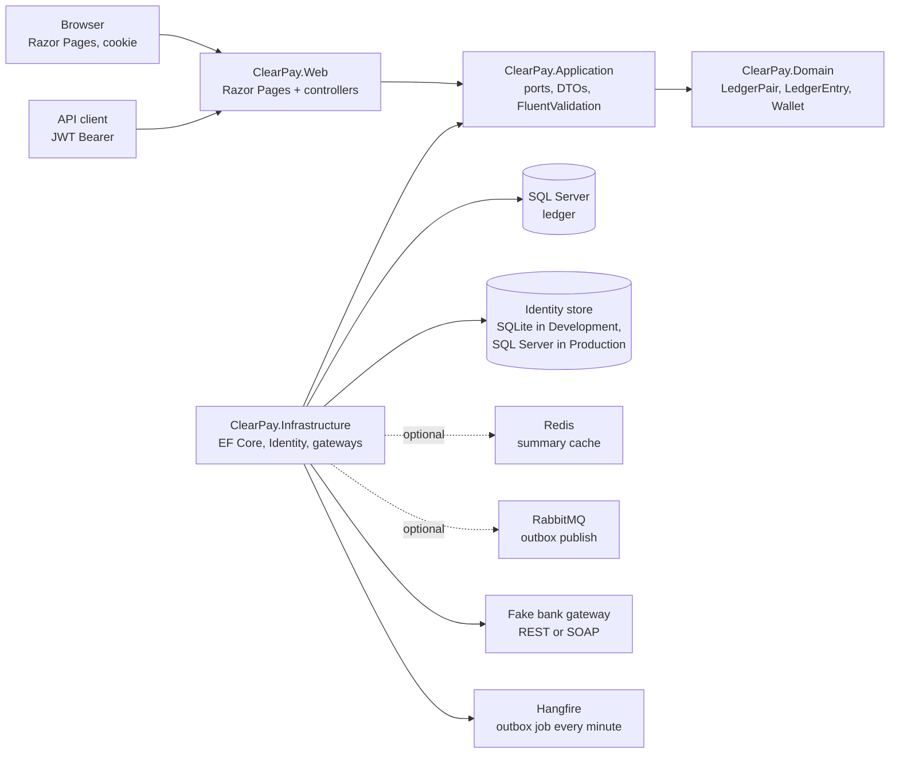
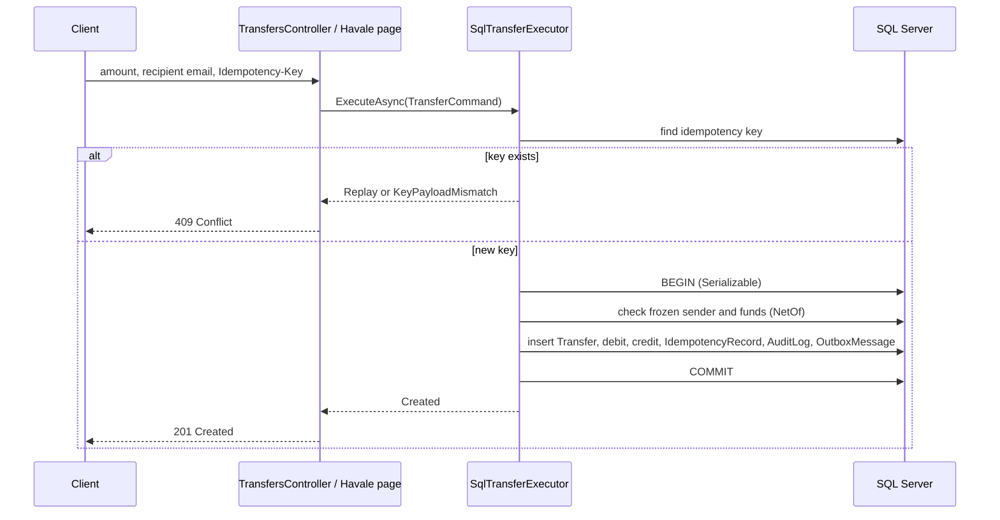

<div align="center">


# ClearPay

**Demo digital wallet on ASP.NET Core 8: double-entry SQL ledger, idempotent transfers, outbox, and a fake bank gateway.**
<br/>
<sub>ASP.NET Core 8 üzerinde demo dijital cüzdan: çift kayıtlı SQL defteri, idempotent transferler, outbox ve sahte banka gateway'i.</sub>


<p><a href="#english">English</a> · <a href="#turkce">Türkçe</a></p>

</div>

| | |
|---|---|
| **Type · Tür** | Web application + JSON API · Web uygulaması + JSON API |
| **Status · Durum** | Active portfolio project; runs locally, Azure hosting not live yet · Aktif portfolyo projesi; yerelde çalışır, Azure yayını henüz canlı değil |
| **Stack · Teknoloji** | .NET 8, ASP.NET Core Razor Pages + Web API, EF Core 8, SQL Server, ASP.NET Core Identity, JWT, Hangfire, Redis, RabbitMQ, xUnit |
| **UI languages · Arayüz dilleri** | Turkish, English, German, French · Türkçe, İngilizce, Almanca, Fransızca |
| **Category · Kategori** | Portfolio / Flagship · Portfolyo / Ana proje |

> [!WARNING]
> Demo only. The bank gateway is fake, no real money moves, and ClearPay is not a licensed e-money institution.
>
> **TR —** Yalnızca demodur. Banka gateway'i sahtedir, gerçek para hareket etmez ve ClearPay lisanslı bir elektronik para kuruluşu değildir.

| Sign-in · Giriş | Wallet summary · Cüzdan özeti |
|:---:|:---:|
|  |  |
| `/giris` with TR · EN · DE · FR switch · Dil seçicili giriş sayfası | Balance, monthly in/out, recent movements · Bakiye, aylık giriş/çıkış, son hareketler |

<sub>Screenshots were taken from a local development build in August 2026 that already included work from open pull requests (demo TC sign-in tab, "Kartlarım" link). The `main` branch has the same pages without those two items. · Ekran görüntüleri Ağustos 2026'da, açık pull request'lerdeki çalışmaları da içeren yerel bir geliştirme derlemesinden alınmıştır (demo TC giriş sekmesi, "Kartlarım" bağlantısı). `main` dalında aynı sayfalar bu iki öğe olmadan bulunur.</sub>

---

<a id="english"></a>

## Overview

ClearPay is a WePay-style demo wallet: users register, top up from a fake bank, send money to another user by email, see their movements and print a receipt; an admin can freeze wallets and requeue failed outbox messages. The point of the project is the money core, not the UI. There is no balance column: the balance is computed from signed ledger rows, every transfer is a debit/credit pair written in one serializable SQL transaction together with the idempotency key, audit row and outbox message, and replaying the same `Idempotency-Key` returns **409 Conflict** instead of charging twice.

## Problem and approach

| Common demo shortcut | What ClearPay does instead | Where |
|---|---|---|
| `wallet.Balance -= amount` | Balance = `LedgerPair.NetOf` over `LedgerEntry` rows; `Wallet` has no balance field | `src/ClearPay.Domain/Ledger/LedgerPair.cs` |
| Retry after a timeout charges twice | Unique `IdempotencyRecord.Key`; same key + same payload → 409 with the original `transferId`; same key + different payload → 409 | `SqlTransferExecutor`, `SqlIdempotencyStore` |
| Several `SaveChanges` calls | Debit, credit, `Transfer`, idempotency, `AuditLog`, `OutboxMessage` in one `Serializable` transaction | `src/ClearPay.Infrastructure/Persistence/SqlTransferExecutor.cs` |
| Publish events inline | Transactional outbox; when Hangfire is enabled (on in Development) a job runs every minute and publishes to RabbitMQ, or logs when RabbitMQ is not configured | `SqlOutboxProcessor`, `Jobs/OutboxHangfireJob.cs`, `Messaging/` |
| Bank call inside the DB transaction | Gateway first; a timeout writes no ledger rows, only a pending outbox record | `SqlFundingExecutor`, `Banking/` |

## Features

| Area | Capability | Where |
|---|---|---|
| Wallet summary | Balance, this month's in/out, last movements, frozen badge; Redis-cached when available, zeros instead of a 500 if SQL is down | `Pages/Index`, `SqlWalletReader`, `CachedWalletReader` |
| Transfer (web) | Review → edit → confirm flow, per-form idempotency key | `Pages/Havale` |
| Transfer (API) | `POST /api/transfers` with JWT and `Idempotency-Key`: 201, 409, 422, 403, 404, 503 as ProblemDetails | `Controllers/TransfersController.cs` |
| Top-up / withdraw | Fake REST or SOAP gateway (`BankGateway:Strategy`), `TIMEOUT` / `FAIL` hints to simulate errors, demo linked cards stored as last four digits only | `Pages/YukleCek`, `Banking/`, `SqlLinkedInstrumentStore` |
| Movements and receipt | Paged activity with date range, receipt per correlation id with print button | `Pages/Hareketler`, `Pages/Dekont`, `SqlActivityReader` |
| Admin | Freeze / unfreeze wallet by email, failed outbox list + requeue, audit search | `Pages/Admin`, `SqlAdminPanel` |
| Auth | ASP.NET Core Identity cookie for the site, JWT via `POST /api/token` for API clients, optional Google and Apple sign-in when secrets are set | `Infrastructure/Identity/`, `Controllers/TokenController.cs` |
| Localization | TR (default), EN, DE, FR resource files and culture cookie | `Localization/`, `Resources/Localization/` |
| API docs | Swagger UI at `/swagger` with an `Idempotency-Key` operation filter; `/api/health` reports Redis and RabbitMQ state | `OpenApi/`, `Program.cs` |

## Architecture



<sub>Project references point inward; `ArchitectureTests` checks that Domain has no references and Application references only Domain. Dashed services are used only when their connection string resolves.</sub>

### Transfer sequence



## Repository structure

```text
clearpay/
├── src/
│   ├── ClearPay.Domain/          # ledger types, LedgerPair rules, AppRoles (no packages, no references)
│   ├── ClearPay.Application/     # ports (IWalletReader, ITransferExecutor, IBankGateway, ...), commands, validators
│   ├── ClearPay.Infrastructure/  # EF Core contexts and migrations, SQL executors, Identity, JWT, Redis, RabbitMQ, Hangfire, gateways
│   └── ClearPay.Web/             # Razor Pages, API controllers, localization, Swagger, Program.cs
├── tests/ClearPay.Tests/         # xUnit + FluentAssertions + WebApplicationFactory (114 tests)
├── infra/                        # Azure Bicep (App Service F1 + Azure SQL Basic) and deploy.ps1
├── docs/                         # SPEC, ARCHITECTURE, TASKS, CANLI (go-live list) and planning notes
├── .cursor/                      # agent rules and skills used during development
├── docker-compose.yml            # SQL Server 2022, Redis 7, RabbitMQ 3.13 (the web app is not containerized)
└── ClearPay.slnx
```

## Data and auth

| Table | Purpose |
|---|---|
| `Wallet` | One per user (unique `UserId`), `IsFrozen`; no balance column |
| `LedgerEntry` | Signed amount, `PairId`, `CorrelationId`, optional `TransferId`, `Kind`; indexed by wallet and time |
| `Transfer` | From/to wallet, amount, status, correlation id |
| `IdempotencyRecord` | Unique key, scope, request hash, resulting resource id |
| `AuditLog`, `OutboxMessage` | Written in the same transaction as the money movement |
| `LinkedInstrument` | Demo card: last four digits + label, unique per user; no PAN or CVV |

Two EF Core contexts are used: `ClearPayDbContext` (ledger, migrations `InitialLedger`, `AddLinkedInstrument`, applied at startup unless `ClearPay:ApplyLedgerMigrations=false`) and `AppIdentityDbContext` (Identity). `Wallet.UserId` holds the Identity user id without a foreign key, because the two contexts are separate. Roles are `Musteri` and `Admin`; in Development a seeded admin user is created by `IdentitySeeder`.

## Setup

**Prerequisites:** .NET 8 SDK and a SQL Server instance for the ledger. Docker Desktop is optional (SQL Server, Redis, RabbitMQ via `docker-compose.yml`).

| Setting | Development default | Notes |
|---|---|---|
| `ConnectionStrings:ClearPay` | local default SQL Server instance, Windows auth (`appsettings.Development.json`) | Point it to your own server; use user secrets for SQL logins |
| `ConnectionStrings:Identity` | SQLite file `App_Data/identity.db` | Production uses `ConnectionStrings:ClearPay` |
| `Redis`, `RabbitMq` | `localhost` | Optional; the app falls back to no cache and log-only publishing |
| `Jwt:SigningKey` | development key in `appsettings.Development.json` | Must be replaced outside Development |
| `Authentication:Google:*`, `Authentication:Apple:*` | empty | Set with `dotnet user-secrets`; see `docs/GIRIS-SOSYAL.md` |

```bash
# optional local services
docker compose up -d
```

## Run

```bash
dotnet run --project src/ClearPay.Web --launch-profile http
```

Open `http://localhost:5153/giris`. Swagger: `http://localhost:5153/swagger`, health: `http://localhost:5153/api/health`. The Development admin user is defined in `src/ClearPay.Infrastructure/Identity/IdentitySeeder.cs`.

## Testing and CI

```bash
dotnet test tests/ClearPay.Tests/ClearPay.Tests.csproj
```

The suite covers `LedgerPair` invariants, transfer and funding executors, idempotency replay (409), outbox processing, RabbitMQ publisher, cache decorator, architecture rules, auth flows, localization and Swagger. Tests run against SQLite files with Hangfire, Redis and RabbitMQ switched off, so no SQL Server is needed. For this README, `dotnet test` was run on `main`: **114 passed, 0 failed**.

GitHub Actions: `ci.yml` builds and tests on every push to `main` and on pull requests (passing on the latest `main` commit). `azure-deploy.yml` publishes to Azure App Service when the `AZURE_WEBAPP_NAME` variable is set; its latest run on `main` failed.

## Engineering notes

- **Serializable transaction + double check of the key.** The key is looked up before and inside the transaction, and a unique-index violation is also mapped to a replay, so concurrent duplicates cannot both commit.
- **Request fingerprint.** The idempotency record stores a hash of recipient, amount and description; reusing a key with a different payload is rejected rather than silently replayed.
- **Graceful degradation.** `LedgerUnavailable` maps SQL timeouts to 503 on the API and to a zero summary on the page; Redis and RabbitMQ are optional at runtime.
- **Clean Architecture enforced by tests**, not only by folder names.
- **SQL command timeout of 8 seconds** keeps the UI responsive when the database is unreachable.

## Limitations

- Not deployed: the Azure resources exist in Bicep, but live hosting (TASK-16 in `docs/TASKS.md`) is not done and the latest deploy workflow run failed.
- The bank gateway is a stub; there is no real payment, card or bank integration.
- Identity uses SQLite in Development and SQL Server only in Production.
- Local development defaults (SQL Server `sa` password in `appsettings.json`, `docker-compose.yml`, `.env.example`, and a JWT signing key in `appsettings.Development.json`) are committed. They are meant for local containers only and must be overridden for any shared environment.
- The Flutter client, JWT wallet/cards/admin APIs and SQL-backed Identity are in open pull requests (#2–#8), not on `main`. `README.tr.md`, `README.de.md` and `README.fr.md` still describe that future state.
- No load or concurrency testing beyond the unit and integration tests.

## Status

Active. `main` contains the web wallet, the transfer API and the ledger core with a passing test suite. Mobile and extra APIs are in review on separate branches.

---

<a id="turkce"></a>

## Genel Bakış

ClearPay, WePay tarzı bir demo cüzdandır: kullanıcı kayıt olur, sahte bankadan bakiye yükler, başka bir kullanıcıya e-posta adresiyle para gönderir, hareketlerini görür ve dekont yazdırır; yönetici cüzdanları dondurabilir ve başarısız outbox mesajlarını yeniden kuyruğa alabilir. Projenin odağı arayüz değil, para çekirdeğidir. Bakiye kolonu yoktur: bakiye işaretli defter kayıtlarından hesaplanır, her transfer tek bir serializable SQL transaction'ı içinde idempotency anahtarı, denetim kaydı ve outbox mesajıyla birlikte yazılan bir borç/alacak çiftidir ve aynı `Idempotency-Key` tekrar gönderildiğinde iki kez çekim yapmak yerine **409 Conflict** döner.

## Problem ve yaklaşım

| Yaygın demo kısayolu | ClearPay'in yaptığı | Konum |
|---|---|---|
| `wallet.Balance -= amount` | Bakiye = `LedgerEntry` kayıtları üzerinde `LedgerPair.NetOf`; `Wallet` sınıfında bakiye alanı yok | `src/ClearPay.Domain/Ledger/LedgerPair.cs` |
| Zaman aşımı sonrası tekrar deneme iki kez çeker | Tekil `IdempotencyRecord.Key`; aynı anahtar + aynı içerik → orijinal `transferId` ile 409; aynı anahtar + farklı içerik → 409 | `SqlTransferExecutor`, `SqlIdempotencyStore` |
| Birden çok `SaveChanges` çağrısı | Borç, alacak, `Transfer`, idempotency, `AuditLog`, `OutboxMessage` tek `Serializable` transaction içinde | `src/ClearPay.Infrastructure/Persistence/SqlTransferExecutor.cs` |
| Olayları anında yayınlamak | Transactional outbox; Hangfire etkinse (Development ortamında açık) bir iş her dakika çalışır ve RabbitMQ'ya yayınlar, RabbitMQ yapılandırılmamışsa loglar | `SqlOutboxProcessor`, `Jobs/OutboxHangfireJob.cs`, `Messaging/` |
| Banka çağrısını DB transaction'ı içinde yapmak | Önce gateway; zaman aşımında defter kaydı yazılmaz, yalnızca bekleyen bir outbox kaydı oluşur | `SqlFundingExecutor`, `Banking/` |

## Özellikler

| Alan | Yetenek | Konum |
|---|---|---|
| Cüzdan özeti | Bakiye, bu ayın giriş/çıkışı, son hareketler, dondurulmuş rozeti; varsa Redis önbelleği, SQL kapalıysa 500 yerine sıfır değerler | `Pages/Index`, `SqlWalletReader`, `CachedWalletReader` |
| Havale (web) | Gözden geçir → düzenle → onayla akışı, form başına idempotency anahtarı | `Pages/Havale` |
| Havale (API) | JWT ve `Idempotency-Key` ile `POST /api/transfers`: ProblemDetails olarak 201, 409, 422, 403, 404, 503 | `Controllers/TransfersController.cs` |
| Yükle / çek | Sahte REST veya SOAP gateway (`BankGateway:Strategy`), hata simülasyonu için `TIMEOUT` / `FAIL` ipuçları, yalnızca son dört hanesi saklanan demo kartlar | `Pages/YukleCek`, `Banking/`, `SqlLinkedInstrumentStore` |
| Hareketler ve dekont | Tarih aralıklı sayfalı hareket listesi, correlation id başına yazdırılabilir dekont | `Pages/Hareketler`, `Pages/Dekont`, `SqlActivityReader` |
| Yönetim | E-posta ile cüzdan dondurma / çözme, başarısız outbox listesi + yeniden kuyruğa alma, denetim kaydı arama | `Pages/Admin`, `SqlAdminPanel` |
| Kimlik | Site için ASP.NET Core Identity cookie, API istemcileri için `POST /api/token` ile JWT, sırlar tanımlıysa Google ve Apple girişi | `Infrastructure/Identity/`, `Controllers/TokenController.cs` |
| Yerelleştirme | TR (varsayılan), EN, DE, FR kaynak dosyaları ve kültür cookie'si | `Localization/`, `Resources/Localization/` |
| API dokümantasyonu | `/swagger` altında `Idempotency-Key` filtreli Swagger UI; `/api/health` Redis ve RabbitMQ durumunu bildirir | `OpenApi/`, `Program.cs` |

## Mimari

Mimari ve transfer sıralama diyagramları İngilizce bölümdekiyle aynıdır (etiketler teknik tanımlayıcı olduğu için İngilizce bırakıldı): [diyagramlara git](#english). Proje referansları içe doğrudur; `ArchitectureTests`, Domain projesinin hiçbir referansı olmadığını ve Application'ın yalnızca Domain'e referans verdiğini test eder. Redis ve RabbitMQ yalnızca bağlantı dizeleri çözülebiliyorsa kullanılır.

## Depo yapısı

```text
clearpay/
├── src/
│   ├── ClearPay.Domain/          # defter tipleri, LedgerPair kuralları, AppRoles (paket ve referans yok)
│   ├── ClearPay.Application/     # port'lar (IWalletReader, ITransferExecutor, IBankGateway, ...), komutlar, doğrulayıcılar
│   ├── ClearPay.Infrastructure/  # EF Core context'leri ve migration'lar, SQL yürütücüler, Identity, JWT, Redis, RabbitMQ, Hangfire, gateway'ler
│   └── ClearPay.Web/             # Razor Pages, API controller'ları, yerelleştirme, Swagger, Program.cs
├── tests/ClearPay.Tests/         # xUnit + FluentAssertions + WebApplicationFactory (114 test)
├── infra/                        # Azure Bicep (App Service F1 + Azure SQL Basic) ve deploy.ps1
├── docs/                         # SPEC, ARCHITECTURE, TASKS, CANLI (canlıya alma listesi) ve planlama notları
├── .cursor/                      # geliştirme sırasında kullanılan ajan kuralları ve skill'ler
├── docker-compose.yml            # SQL Server 2022, Redis 7, RabbitMQ 3.13 (web uygulaması container'da değil)
└── ClearPay.slnx
```

## Veri ve kimlik

| Tablo | Amaç |
|---|---|
| `Wallet` | Kullanıcı başına bir tane (tekil `UserId`), `IsFrozen`; bakiye kolonu yok |
| `LedgerEntry` | İşaretli tutar, `PairId`, `CorrelationId`, isteğe bağlı `TransferId`, `Kind`; cüzdan ve zamana göre indeksli |
| `Transfer` | Gönderen/alıcı cüzdan, tutar, durum, correlation id |
| `IdempotencyRecord` | Tekil anahtar, kapsam, istek hash'i, oluşan kaynağın kimliği |
| `AuditLog`, `OutboxMessage` | Para hareketiyle aynı transaction içinde yazılır |
| `LinkedInstrument` | Demo kart: son dört hane + etiket, kullanıcı başına tekil; PAN veya CVV yok |

İki EF Core context'i vardır: `ClearPayDbContext` (defter; `InitialLedger` ve `AddLinkedInstrument` migration'ları, `ClearPay:ApplyLedgerMigrations=false` yapılmadıkça açılışta uygulanır) ve `AppIdentityDbContext` (Identity). İki context ayrı olduğu için `Wallet.UserId`, Identity kullanıcı kimliğini foreign key olmadan tutar. Roller `Musteri` ve `Admin`'dir; Development ortamında `IdentitySeeder` bir yönetici kullanıcı oluşturur.

## Kurulum

**Ön koşullar:** .NET 8 SDK ve defter için bir SQL Server örneği. Docker Desktop isteğe bağlıdır (`docker-compose.yml` ile SQL Server, Redis, RabbitMQ).

| Ayar | Development varsayılanı | Not |
|---|---|---|
| `ConnectionStrings:ClearPay` | yerel varsayılan SQL Server örneği, Windows kimlik doğrulaması (`appsettings.Development.json`) | Kendi sunucunuza yönlendirin; SQL kullanıcıları için user secrets kullanın |
| `ConnectionStrings:Identity` | SQLite dosyası `App_Data/identity.db` | Production ortamında `ConnectionStrings:ClearPay` kullanılır |
| `Redis`, `RabbitMq` | `localhost` | İsteğe bağlı; uygulama önbelleksiz çalışmaya ve yalnızca loglayan yayıncıya düşer |
| `Jwt:SigningKey` | `appsettings.Development.json` içinde geliştirme anahtarı | Development dışında mutlaka değiştirilmelidir |
| `Authentication:Google:*`, `Authentication:Apple:*` | boş | `dotnet user-secrets` ile girin; bkz. `docs/GIRIS-SOSYAL.md` |

```bash
# isteğe bağlı yerel servisler
docker compose up -d
```

## Çalıştırma

```bash
dotnet run --project src/ClearPay.Web --launch-profile http
```

`http://localhost:5153/giris` adresini açın. Swagger: `http://localhost:5153/swagger`, health: `http://localhost:5153/api/health`. Development yönetici kullanıcısı `src/ClearPay.Infrastructure/Identity/IdentitySeeder.cs` içinde tanımlıdır.

## Test ve CI

```bash
dotnet test tests/ClearPay.Tests/ClearPay.Tests.csproj
```

Testler `LedgerPair` değişmezlerini, transfer ve yükleme yürütücülerini, idempotency tekrarını (409), outbox işleme, RabbitMQ yayıncısını, önbellek dekoratörünü, mimari kuralları, kimlik akışlarını, yerelleştirmeyi ve Swagger'ı kapsar. Testler Hangfire, Redis ve RabbitMQ kapalıyken SQLite dosyalarıyla çalışır, SQL Server gerekmez. Bu README için `main` üzerinde `dotnet test` çalıştırıldı: **114 başarılı, 0 başarısız**.

GitHub Actions: `ci.yml`, `main`'e her push'ta ve pull request'lerde derleyip test eder (son `main` commit'inde başarılı). `azure-deploy.yml`, `AZURE_WEBAPP_NAME` değişkeni tanımlıysa Azure App Service'e yayınlar; `main` üzerindeki son çalışması başarısız oldu.

## Mühendislik notları

- **Serializable transaction + anahtarın iki kez kontrolü.** Anahtar transaction öncesinde ve içinde aranır; tekil indeks ihlali de tekrar olarak yorumlanır, böylece eşzamanlı kopyaların ikisi birden commit edilemez.
- **İstek parmak izi.** Idempotency kaydı alıcı, tutar ve açıklamanın hash'ini saklar; aynı anahtarın farklı içerikle kullanılması sessizce tekrar edilmez, reddedilir.
- **Kontrollü bozulma.** `LedgerUnavailable`, SQL zaman aşımlarını API'de 503'e, sayfada sıfır özete dönüştürür; Redis ve RabbitMQ çalışma anında isteğe bağlıdır.
- **Clean Architecture testlerle korunur**, yalnızca klasör adlarıyla değil.
- **8 saniyelik SQL komut zaman aşımı**, veritabanına ulaşılamadığında arayüzün yanıt vermeye devam etmesini sağlar.

## Sınırlamalar

- Yayında değil: Azure kaynakları Bicep ile tanımlı, ancak canlı yayın (`docs/TASKS.md` içinde TASK-16) tamamlanmadı ve son deploy iş akışı başarısız oldu.
- Banka gateway'i bir taslaktır; gerçek ödeme, kart veya banka entegrasyonu yoktur.
- Identity, Development ortamında SQLite, yalnızca Production ortamında SQL Server kullanır.
- Yerel geliştirme varsayılanları (`appsettings.json`, `docker-compose.yml`, `.env.example` içindeki SQL Server `sa` parolası ve `appsettings.Development.json` içindeki JWT imzalama anahtarı) repoya eklenmiştir. Yalnızca yerel container'lar içindir ve paylaşılan her ortamda değiştirilmelidir.
- Flutter istemcisi, JWT cüzdan/kart/yönetim API'leri ve SQL tabanlı Identity açık pull request'lerdedir (#2–#8), `main` dalında değildir. `README.tr.md`, `README.de.md` ve `README.fr.md` hâlâ bu gelecekteki durumu anlatır.
- Birim ve entegrasyon testleri dışında yük veya eşzamanlılık testi yoktur.

## Durum

Aktif. `main` dalı web cüzdanını, transfer API'sini ve geçen test paketiyle birlikte defter çekirdeğini içerir. Mobil istemci ve ek API'ler ayrı dallarda incelemededir.
