# ClearPay

| **English** | [Türkçe](./README.tr.md) | [Deutsch](./README.de.md) | [Français](./README.fr.md) |
|:-----------:|:-----------------------:|:------------------------:|:--------------------------:|

<p align="center">

<strong>English</strong> · [Türkçe](./README.tr.md) · [Deutsch](./README.de.md) · [Français](./README.fr.md)

</p>

<p align="center">
  
</p>

<p align="center">
  <a href="https://github.com/HalilMertDeveli/clearpay/actions/workflows/ci.yml"></a>
  
  
  
  
  <a href="LICENSE"></a>
</p>

<p align="center">
  
</p>

<p align="center">
  <b>Demo digital wallet</b> — ASP.NET Core 8 + Flutter, one SQL Server ledger, no <code>UPDATE Balance</code>.<br>
  Fake bank gateway. <b>Not</b> a licensed e-money institution. <b>Not</b> Papara / FAST / a retail bank clone.
</p>

I am **Halil Mert Develi**. This is the interview repo I defend (Intertech, Softtech): double-entry, idempotent HTTP, two clients, one cash register.

<p align="center">
  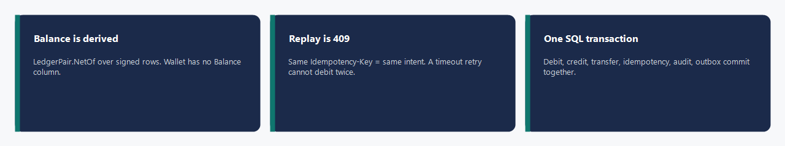
</p>

**Backend deep dives:** [Card payments (mock 3D Secure)](#card-payments-mock-3d-secure) · [SQL performance (measured)](#sql-performance-measured) · [Tracing a payment](#tracing-a-payment-observability) · [Docs](#docs)

---

## Website

Razor Pages at [http://localhost:5153](http://localhost:5153) (Development seed `admin@clearpay.test` / `Deneme123`). A Canada Central App Service hostname exists, but `/api/health` still returns **404** — live HTTPS is **TASK-16**, so these shots are **local**. Not a licensed bank UI.

| Sign-in `/giris` | Summary after login |
|:----------------:|:-------------------:|
| 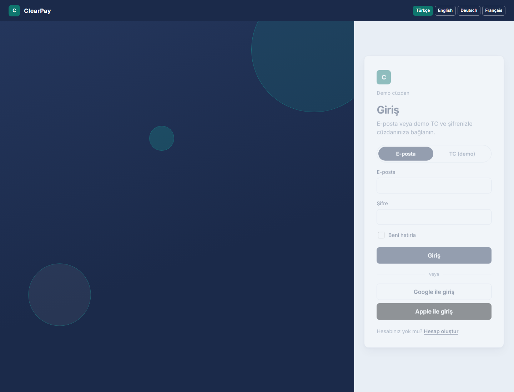 | 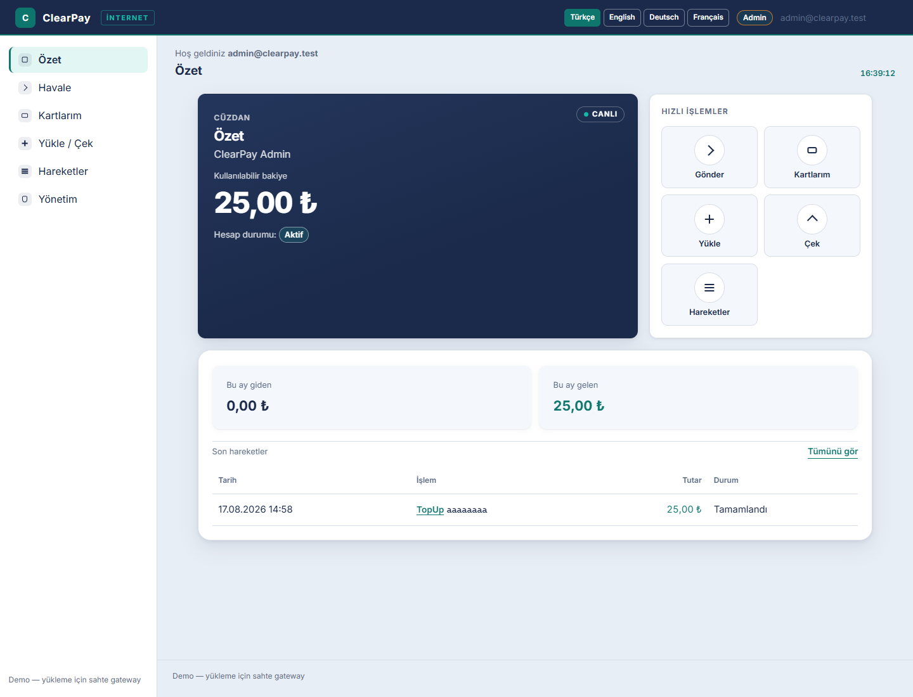 |
| Language bar TR · EN · DE · FR. Demo wallet. | Same SQL ledger. Balance is `LedgerPair.NetOf`. |

| Register `/kayit` | Cards `/kartlar` |
|:-----------------:|:----------------:|
| 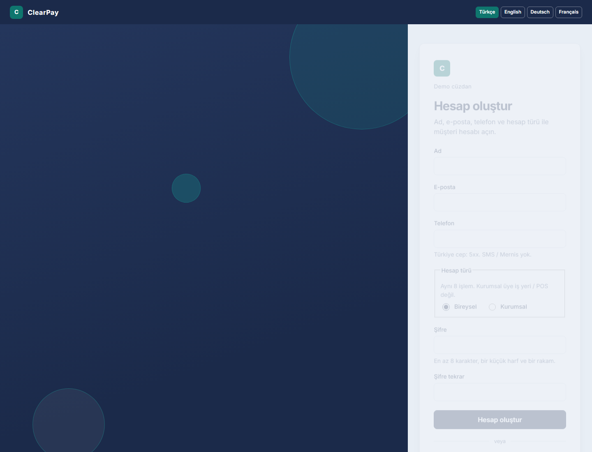 | 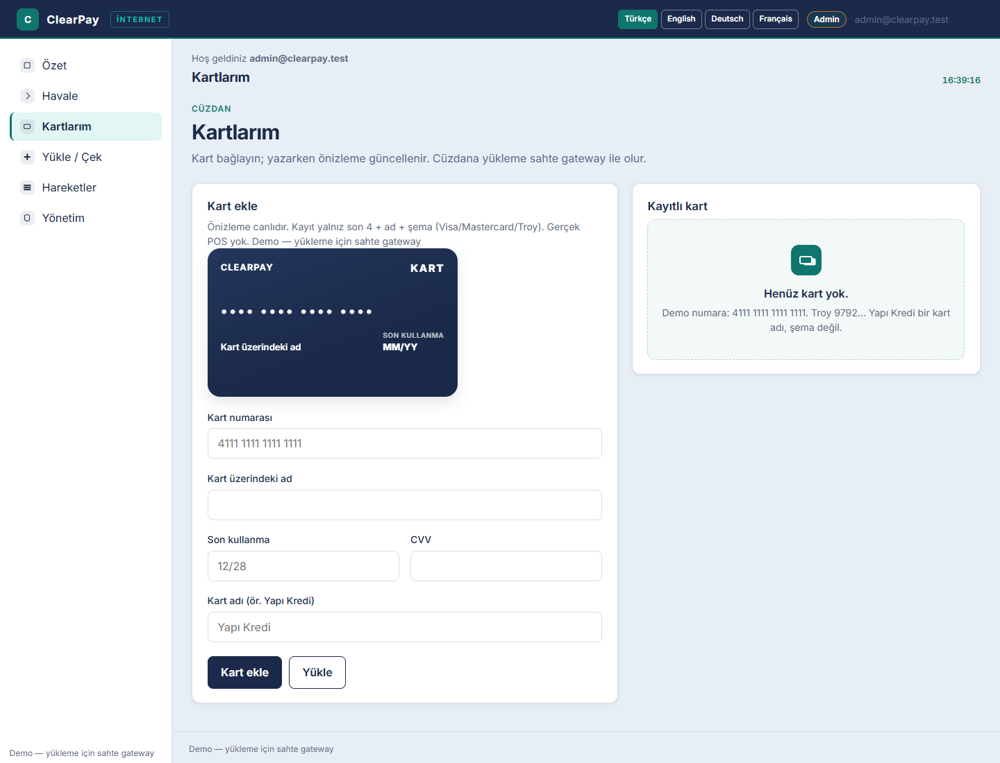 |
| Cookie Identity. Same four languages. | Last four + scheme only. No PAN in SQL. Fake gateway. |

---

## Mobile app

Flutter JWT client on Android emulator `emulator-5554` → `http://10.0.2.2:5153`. Same wallet screens as the website (including Kartlarım), same SQL. **Not** a Hive / Firestore cash register. Firestore may write `app_meta/ping` only.

<p align="center">
  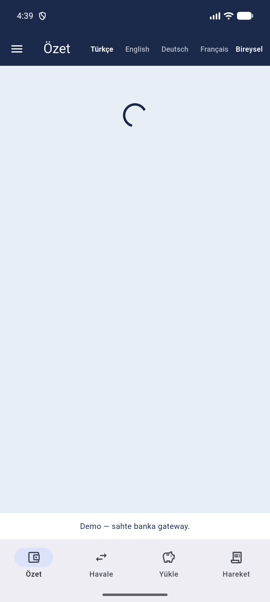
</p>

<p align="center"><i>Özet — language strip in chrome, demo footer. Wallet rows come from JWT → SQL (spinner while the local API answers).</i></p>

<p align="center">
  
</p>

---

## Why it exists

Most demo wallets store a number on `Wallet.Balance` and patch it. ClearPay does not.

| Rule | What the code does |
|------|-------------------|
| **Balance is derived** | `LedgerPair.NetOf` over signed `LedgerEntry` rows. There is no balance column. |
| **Replay is 409** | Same `Idempotency-Key` = same intent. A timeout retry must not debit twice. |
| **One SQL transaction** | Debit, credit, transfer, idempotency, audit, and outbox commit together. |
| **Outbox first** | The message row is in that transaction. Hangfire (and Rabbit when bound) publish after commit. |
| **Two clients, one ledger** | Website (cookie) and Flutter (JWT) hit the same Application ports. The phone has no Hive / SQLite / Firestore wallet. |

---

## Two clients

| | Website | Mobile app |
|--|---------|------------|
| Path | `src/ClearPay.Web` | [`mobile/clearpay`](mobile/clearpay) |
| UI | Razor Pages, TR / EN / DE / FR | Flutter 3.41, TR default, same four languages |
| Auth | ASP.NET Identity cookie | JWT Bearer (`POST /api/token`) |
| Money | Application ports → SQL | **Same ports.** No second cash register |
| Extra | [`/kartlar`](http://localhost:5153/kartlar) — demo linked cards (last four + scheme, no PAN) | Flutter **Kartlarım** — same last four + scheme; `GET/POST /api/cards`; PAN not in SQL |

Flutter **web is not a product**. The browser product is Razor. Android emulator uses `http://10.0.2.2:5153`; Windows / iOS use `http://localhost:5153`.

---

## Run it

.NET 8 SDK. Development uses **SQL Server LocalDB** `(localdb)\MSSQLLocalDB` / database `ClearPay` for Identity **and** the ledger.

```bash
dotnet run --project src/ClearPay.Web --launch-profile http
```

Open [http://localhost:5153/giris](http://localhost:5153/giris) — `admin@clearpay.test` / `Deneme123` (Development seed only).

```bat
cd /d D:\ClearPay\clearpay\mobile\clearpay
flutter run -d emulator-5554
```

```bash
dotnet test
dotnet build ClearPay.slnx
```

OpenAPI: [http://localhost:5153/swagger](http://localhost:5153/swagger) · health: [http://localhost:5153/api/health](http://localhost:5153/api/health)

Docker Desktop is optional (SQL 2022 + Redis + Rabbit). App money is **SQL Server only**. MySQL on this machine is a sidecar / Workbench tool — not the wallet. Do not commit `.env`. A Canada Central hostname exists; `/api/health` is still **404**. Live hosting is TASK-16 (`docs/CANLI.md`). This README does not treat that URL as a working product.

---

## What you can click

| | Website | Flutter |
|--|---------|---------|
| Sign in | [`/giris`](http://localhost:5153/giris) | Giriş — email or demo TC `10000000146` |
| Register | [`/kayit`](http://localhost:5153/kayit) | Hesap oluştur |
| Summary | [`/`](http://localhost:5153/) | Özet — `GET /api/wallet` |
| Transfer | [`/havale`](http://localhost:5153/havale) | Havale — `POST /api/transfers` + `Idempotency-Key` → **201 / 409** |
| Cards | [`/kartlar`](http://localhost:5153/kartlar) | Parked (same SQL instruments via API) |
| Top-up / withdraw | [`/yukle-cek`](http://localhost:5153/yukle-cek) | Yükle / Çek — fake gateway, including `TIMEOUT` |
| Movements | [`/hareketler`](http://localhost:5153/hareketler) | Hareketler |
| Receipt | [`/dekont/{id}`](http://localhost:5153/hareketler) | Dekont + PDF bytes from SQL |
| Admin | [`/admin`](http://localhost:5153/admin) | Admin tab (role) |

Language pickers are chrome (cookie `c=` on the site; local file on Flutter), not a tenth screen.

---

## Picture of the build

<p align="center">
  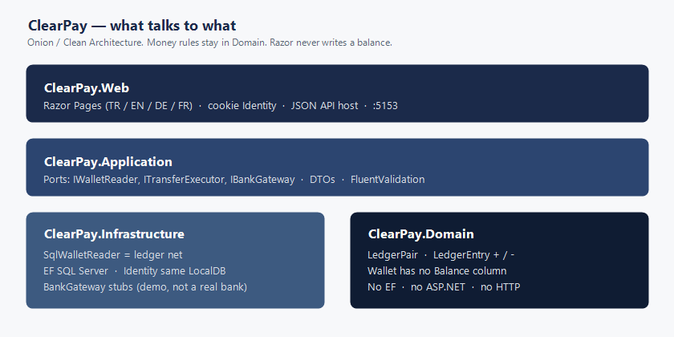
</p>

Web never computes ledger math. The summary page asks `IWalletReader`. Today that adapter is `SqlWalletReader`: balance = `LedgerPair.NetOf`, this month in/out, last five rows, freeze badge. If SQL is down you still get the site — zeros, not a 500.

<p align="center">
  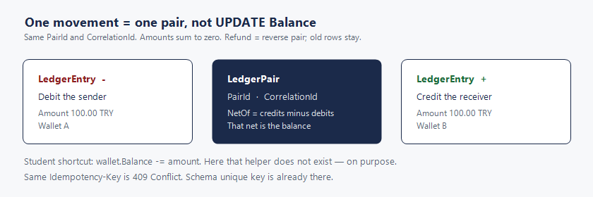
</p>

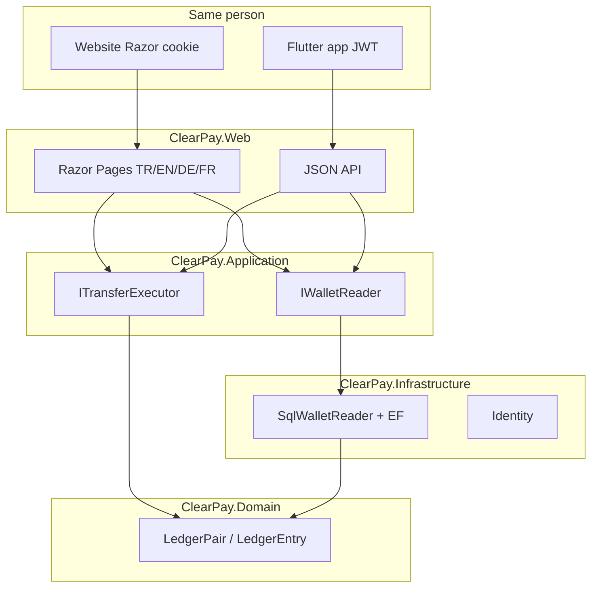

| Layer | Project | Holds | Must not hold |
|-------|---------|-------|----------------|
| UI + host | `ClearPay.Web` | Razor, cookie, culture cookie, `:5153` | Ledger net, `UPDATE Balance` |
| Use cases | `ClearPay.Application` | Ports, DTOs, FluentValidation | Connection strings |
| Adapters | `ClearPay.Infrastructure` | EF SQL Server (Identity + ledger), gateway stubs | Razor / CSS |
| Rules | `ClearPay.Domain` | `LedgerPair`, `Wallet` (no balance field) | EF, HTTP, ASP.NET |

Dependencies point **inward**. Domain does not reference EF or ASP.NET.

---

## Relational schema (SQL Server)

**Demo — fake bank gateway.** Not licensed e-money. Identity and the ledger share one LocalDB database (two EF contexts, two history tables). `Wallet.UserId` matches `AspNetUsers.Id` with **no FK** (two DbContexts). Real FKs are Identity membership plus `LedgerEntry` → `Wallet` / `Transfer`.

`LinkedInstrument` stores **last four + scheme + label** only. PAN / CVV are never persisted.

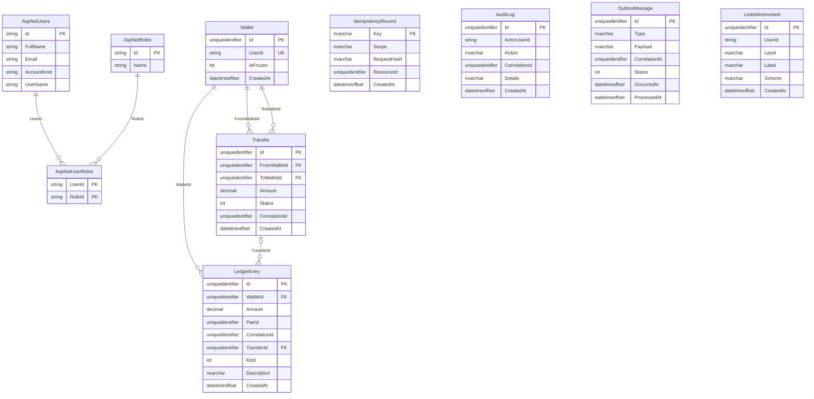

`IdempotencyRecord.Key` is unique (replay → **409**). History tables: `__EFMigrationsHistory` (ledger) and `__EFMigrationsHistoryIdentity`.

---

## Firebase is not the cash register

Flutter initializes Firebase project `clearpay-c0485`. It may write **`app_meta/ping`** (`ok`, `client`, `message`, `touchedAt`) so the console can prove the client is alive.

Money does **not** go there. Balance, transfers, and receipts stay JWT → ASP.NET → SQL Server. Firestore rules deny every other path. Windows desktop skips native Firebase plugins; use the **Android emulator** to see the ping on the sign-in screen.

---

## Card payments (mock 3D Secure)

**Mock card acquiring, not a real bank.** A merchant starts a card payment, the shopper goes through a fake 3D Secure page, and the result comes back signed. The three banks (`MockBankA`, `MockBankB`, `MockPspC`), the ACS page and the SMS code are stubs that run in the same host. No real card is charged. The PAN is used only for BIN routing and the last four digits, then it is dropped.

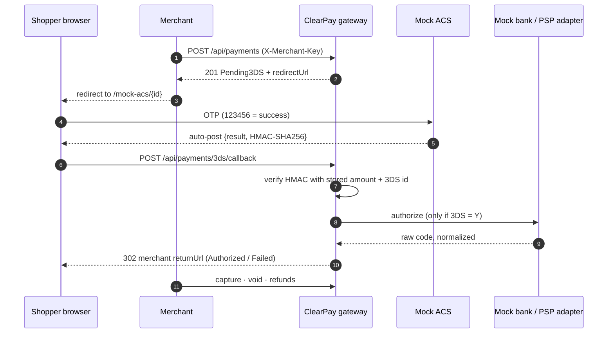

| Rule | What the code does |
|------|-------------------|
| **Explicit state machine** | `Created → Pending3DS → Authorized/Failed → Captured → PartiallyRefunded/Refunded`, plus `Authorized → Voided`. Any other move is a domain error (409). |
| **Signed callback** | HMAC over `paymentId`, 3DS id, result and amount, compared in constant time. A tampered result gets 400 and the payment stays `Pending3DS`. |
| **Idempotent callback** | A second callback does nothing and returns the same redirect: no second bank call, no second event. Parallel duplicates lose on the `Version` concurrency token. |
| **One contract, three banks** | ISO 8583 codes, XML and JSON answers are normalized behind `IAcquirerAdapter`. A BIN router picks the adapter. |
| **Refund limit under concurrency** | The refund amount is reserved and committed first, then the bank is called, then the refund is settled. Total refunds never exceed the captured amount. |
| **Outbox** | Every state change writes a `clearpay.payment.*` row into `OutboxMessage` in the same `SaveChanges`. |

Click through it at [`/demo-magaza`](http://localhost:5153/demo-magaza) (Development; merchant key `dev-demo-shop-key`). Test cards, trigger amounts and known limits are in [`docs/PAYMENTS.md`](docs/PAYMENTS.md).

---

## SQL performance (measured)

The summary and statement screens used to load **every ledger row of the wallet** into C#. They now call T-SQL stored procedures (`usp_Wallet_GetSummary`, `usp_Wallet_GetStatementPage`; `usp_Ledger_GetDailyTotals` is ready for reconciliation) backed by a covering `(WalletId, CreatedAt)` index plus `PairId` and `CreatedAt` indexes — one EF migration, `CREATE OR ALTER` scripts in [`Persistence/Sql`](src/ClearPay.Infrastructure/Persistence/Sql).

Measured on a throwaway SQL Server 2022 container, 600,000 ledger rows, hot treasury wallet = 120,000 rows (warm cache, laptop):

| Query (treasury wallet) | Logical reads before → after | Elapsed before → after | Plan before → after |
|-------------------------|-----------------------------:|-----------------------:|---------------------|
| Summary (balance + month in/out) | 368,223 → **1,392** | 291 ms → **30 ms** | Seek + 120k Key Lookups → covering Seek |
| Statement page 1 | 127,269 → **1,495** | 319 ms → **15 ms** | Clustered Scan + per-row counterparty scans → Seeks |
| Daily totals (1 day) | 10,783 → **13** | 10 ms → **0 ms** | Clustered Scan → Seek |

Full before / after table, method, costs (index space, write probe inconclusive) and the actual `.sqlplan` files: [`docs/SQL-PERF.md`](docs/SQL-PERF.md). Reproduce with `scripts/perf/run-perf.ps1`. Demo data, not a production benchmark.

---

## Tracing a payment (observability)

Every response carries `X-Trace-Id` and `X-Correlation-Id`. Paste either into Seq or Grafana/Tempo and you get the request log line, the `payment topup` / `payment transfer` span, and the SQL spans under it — including the single `INSERT [AuditLog] [IdempotencyRecord] [LedgerEntry] [OutboxMessage]` batch. A mock 3D Secure card payment shows up as `payment card_create` → `payment card_3ds` → child `acquirer authorize` (bank name, normalized and raw response code) → `payment card_capture` / `card_refund`; a forged 3DS signature or an unavailable issuer marks the span as an error.

```bash
docker compose -f docker-compose.observability.yml -p clearpay-obs up -d   # Seq, OTel Collector, Tempo, Prometheus, Grafana
dotnet run --project src/ClearPay.Web --launch-profile http                # Development exports to :5341 / :4317
```

| | |
|--|--|
| Logs | Serilog → console + Seq ([localhost:8341](http://localhost:8341)), enriched with `TraceId`, `SpanId`, `CorrelationId`, opaque `UserId`. PAN-looking numbers and secret-named properties are masked. |
| Traces | OpenTelemetry: ASP.NET Core, HttpClient, SqlClient, `ClearPay.Payments` (wallet + card payments, acquirer calls), `ClearPay.Messaging` → Collector → Tempo + Seq. No PAN, BIN or amount on a span. |
| Metrics | `clearpay_payments_total`, `clearpay_payments_duration_milliseconds`, HTTP RED → Prometheus → Grafana dashboard *ClearPay - Payments* ([localhost:3000](http://localhost:3000)) |

**Honest scope:** the stack runs in local Docker only (no auth, dev settings); Production config leaves `Observability` empty. RabbitMQ trace propagation (`MessageTraceContext`) is ready but not yet called by the publisher. Runbook: [`docs/OBSERVABILITY.md`](docs/OBSERVABILITY.md).

---

## Interview (three sentences)

1. Same `Idempotency-Key` is the same intent: the second HTTP is **409 Conflict** so a timeout retry does not debit twice.
2. Debit, credit, transfer row, idempotency, audit, and outbox commit in **one SQL transaction**; there is no `UPDATE Balance` — balance is `LedgerPair.NetOf`.
3. The outbox row is written in that same transaction so a timeout cannot lose the message; Hangfire (and Rabbit when bound) publish after commit.

---

## CV bullets (intended)

Copy these into LinkedIn / a résumé. Do not add Papara, FAST, licensed e-money, or “I shipped a payments company.”

- Built **ClearPay**, an ASP.NET Core 8 **wallet demo** with idempotent P2P transfers, JWT/cookie auth, and a double-entry ledger on SQL Server (`LedgerPair.NetOf`; no `UPDATE Balance`).
- Same `Idempotency-Key` returns **409 Conflict**; ledger + outbox commit in **one SQL transaction**. Mock BankGateway over REST and SOAP. Razor Pages + Flutter JWT share that ledger. SignalR refreshes the other client (not a second cash register).
- Shipped Docker Compose, xUnit tests, Serilog correlation, and GitHub Actions CI. Public Azure HTTPS is **TASK-16** (you add the publish-profile secret) — not a licensed e-money product.

Full CV pack (TR/EN HTML): `C:\Users\clt\Desktop\Halil_Mert_Develi_CV_Paket`. Repo copy: [`docs/CV-HALIL.md`](docs/CV-HALIL.md).

---

## Repo map

```
src/ClearPay.Domain           LedgerEntry, LedgerPair, Wallet (no Balance), Payments/ (card payment state machine)
src/ClearPay.Application      IWalletReader, ITransferExecutor, IBankGateway, IPaymentGateway, IAcquirerAdapter
src/ClearPay.Infrastructure   SqlWalletReader, EF SQL Server, Identity, Payments/ (mock banks), Persistence/Sql (stored procedures), Observability/
src/ClearPay.Web              Razor + localization + MapControllers, Observability/ (Serilog + OpenTelemetry), Pages/Payments (mock ACS, demo shop)
mobile/clearpay               Flutter JWT client (not in the .slnx)
tests/ClearPay.Tests          LedgerPair, 409, architecture, culture, payments, stored procedures, tracing
scripts/perf/                 Seed + measurement scripts for docs/SQL-PERF.md (throwaway SQL Server)
infra/                        Bicep unused on the live site (T-104); you click Azure Portal
docker-compose.yml            SQL Server 2022 — not the web app
docker-compose.observability.yml  Seq + OTel Collector + Tempo + Prometheus + Grafana (local)
infra/observability/          Collector, Tempo, Prometheus, Grafana provisioning + dashboard
ClearPay.slnx
```

---

## Roadmap (honest)

| Done | Next |
|------|------|
| TASK-01…15 — screens, ledger, 409, gateway, outbox, Redis/Rabbit, tests, Swagger | **TASK-16** — App Service `ClearPay` exists; `/api/health` is still **404**. You add GitHub secret `AZURE_WEBAPP_PUBLISH_PROFILE` + Portal startup `dotnet ClearPay.Web.dll`. Do **not** run `.\infra\deploy.ps1` (it would replace the live site). |
| Flutter JWT app, Kartlarım (web + Flutter), Firestore ping (meta only) | Store listing / working public HTTPS still TASK-16 |
| Mock 3D Secure card payments (3 mock banks, refund / partial refund / void), ledger stored procedures with measured plans, Serilog + OpenTelemetry tracing | RabbitMQ retry + dead-letter queue + idempotent consumers; nightly reconciliation job (Hangfire); notifications and reconciliation as a separate service |

CI on `main` restores and runs `tests/ClearPay.Tests`.

---

## Docs

- [`docs/SPEC.md`](docs/SPEC.md) — screens and money rules
- [`docs/ARCHITECTURE.md`](docs/ARCHITECTURE.md) — onion layers
- [`docs/PAYMENTS.md`](docs/PAYMENTS.md) — mock card payments: 3D Secure, acquirer adapters, refunds
- [`docs/SQL-PERF.md`](docs/SQL-PERF.md) — stored procedures, indexes, measured before / after with execution plans
- [`docs/OBSERVABILITY.md`](docs/OBSERVABILITY.md) — find a payment by TraceId; error-analysis runbook
- [`docs/CANLI.md`](docs/CANLI.md) — Azure click list (no secrets in git)
- [`docs/YOL.md`](docs/YOL.md) — career path; live URL is TASK-16
- [`docs/FARK.md`](docs/FARK.md) — reconciliation-first, not a Papara rival
- [`mobile/clearpay/README.md`](mobile/clearpay/README.md) — Flutter client
- [`docs/API-ESZAMAN.md`](docs/API-ESZAMAN.md) — SignalR hub (not the ledger)

## License

[MIT](LICENSE) © 2026 Halil Mert Develi
