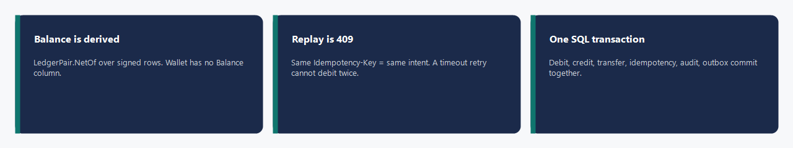
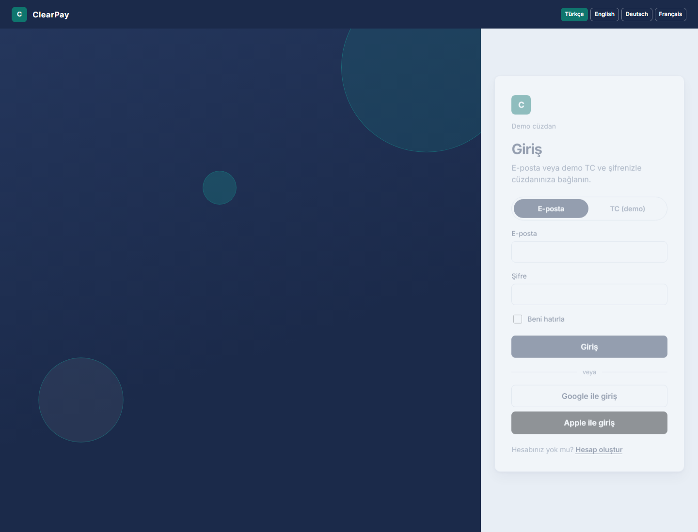
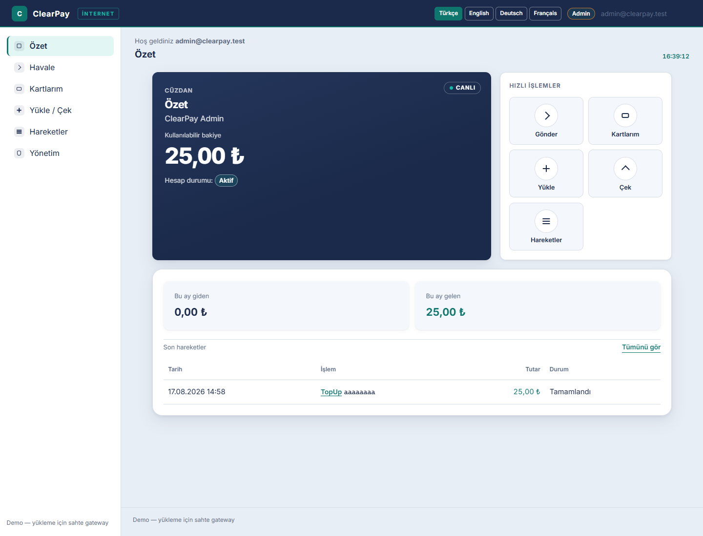
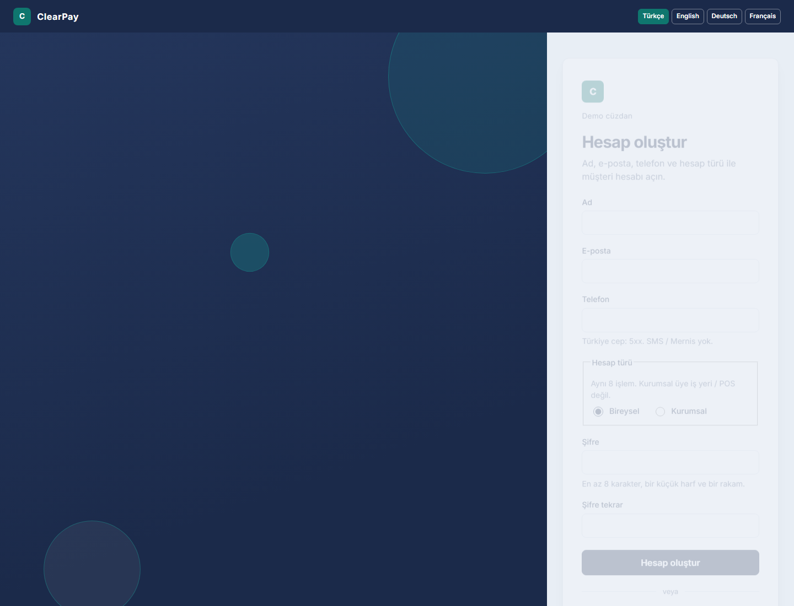
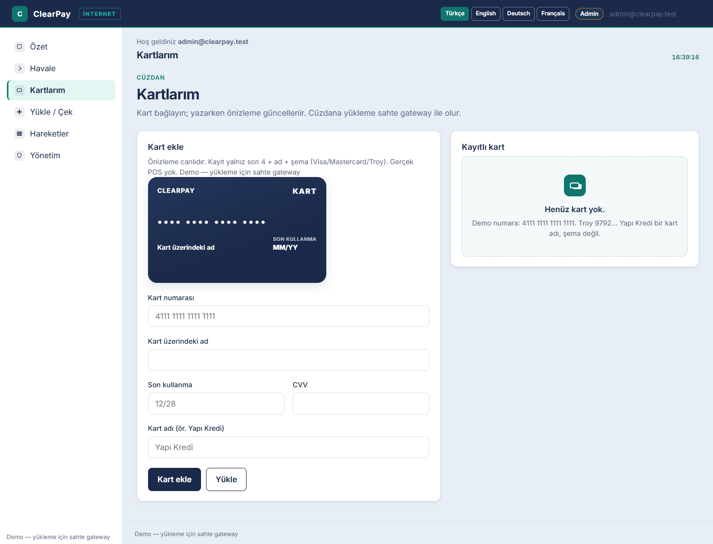
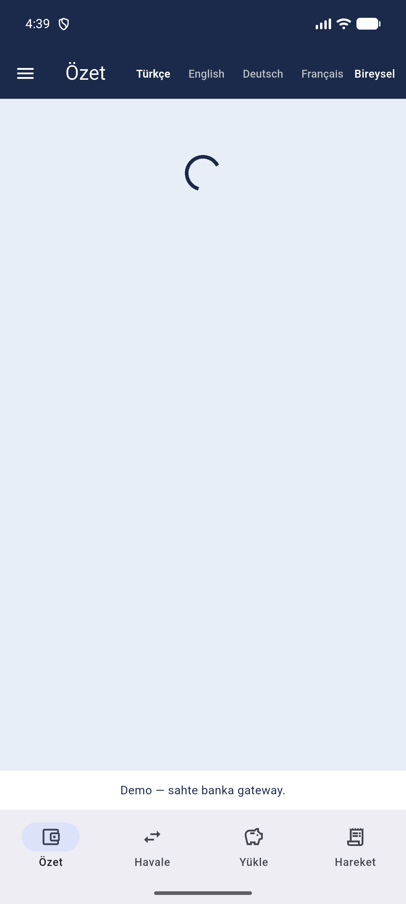
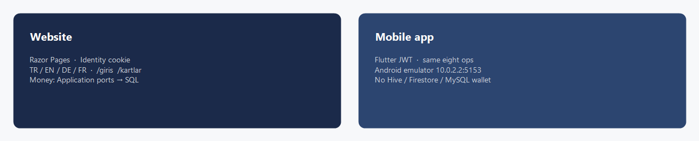
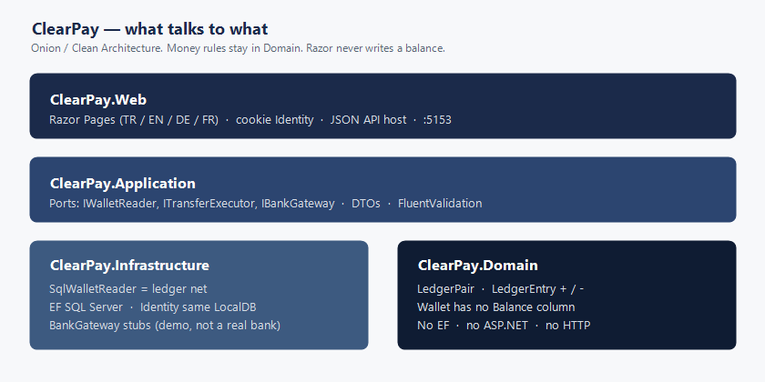
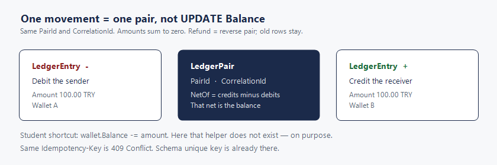

# ClearPay

| [English](./README.md) | **Türkçe** | [Deutsch](./README.de.md) | [Français](./README.fr.md) |
|:---------------------:|:----------:|:------------------------:|:--------------------------:|

<p align="center">

[English](./README.md) · <strong>Türkçe</strong> · [Deutsch](./README.de.md) · [Français](./README.fr.md)

</p>

<p align="center">
  
</p>

<p align="center">
  <a href="https://github.com/HalilMertDeveli/clearpay/actions/workflows/ci.yml"></a>
  
  
  
  
  <a href="LICENSE"></a>
</p>

<p align="center">
  
</p>

<p align="center">
  <b>Demo dijital cüzdan</b> — ASP.NET Core 8 + Flutter, tek SQL Server defteri, <code>UPDATE Balance</code> yok.<br>
  Sahte banka gateway. Lisanslı e-para kuruluşu <b>değil</b>. Papara / FAST / perakende banka kopyası <b>değil</b>.
</p>

Ben **Halil Mert Develi**. Mülakatta savunduğum repo (Intertech, Softtech): çift kayıt, idempotent HTTP, iki istemci, tek kasa.

<p align="center">
  
</p>

**Backend ayrıntıları:** [Ödeme akışı (3D Secure)](#ödeme-akışı-3d-secure) · [SQL performansı](#sql-performansı-ölçüldü) · [Tracing](#tracing-izlenebilirlik) · [Belgeler](#belgeler)

---

## Site

Razor Pages: [http://localhost:5153](http://localhost:5153) (Development seed `admin@clearpay.test` / `Deneme123`). Canada Central App Service adı var; `/api/health` hâlâ **404** — canlı HTTPS **TASK-16**. Bu kareler **yerel**. Lisanslı banka arayüzü değil.

| Giriş `/giris` | Giriş sonrası özet |
|:--------------:|:------------------:|
|  |  |
| Dil çubuğu TR · EN · DE · FR. Demo cüzdan. | Aynı SQL defteri. Bakiye `LedgerPair.NetOf`. |

| Kayıt `/kayit` | Kartlarım `/kartlar` |
|:--------------:|:--------------------:|
|  |  |
| Cookie Identity. Aynı dört dil. | Yalnız son dört + şema. SQL’de PAN yok. Sahte gateway. |

---

## Mobil uygulama

Flutter JWT istemci, Android emülatör `emulator-5554` → `http://10.0.2.2:5153`. Sitedeki aynı cüzdan ekranları (Kartlarım dahil), aynı SQL. Hive / Firestore **kasa değil**. Firestore yalnız `app_meta/ping` yazabilir.

<p align="center">
  
</p>

<p align="center"><i>Özet — chrome’da dil şeridi, demo alt bilgi. Bakiye satırları JWT → SQL (yerel API yavaşsa dönen ikon).</i></p>

<p align="center">
  
</p>

---

## Neden böyle

Çoğu demo cüzdan `Wallet.Balance` tutar ve günceller. ClearPay tutmaz.

| Kural | Kod ne yapar |
|------|----------------|
| **Bakiye türetilir** | İmzalı `LedgerEntry` satırları üzerinde `LedgerPair.NetOf`. Bakiye kolonu yok. |
| **Tekrar 409** | Aynı `Idempotency-Key` = aynı niyet. Timeout retry bakiyeyi iki kez düşürmez. |
| **Tek SQL işlemi** | Borç, alacak, havale, idempotency, audit ve outbox birlikte commit. |
| **Önce outbox** | Mesaj satırı aynı transaction’da. Hangfire (Rabbit bağlıysa o) commit’ten sonra yayınlar. |
| **İki istemci, bir defter** | Site (cookie) ve Flutter (JWT) aynı Application portlarına gider. Telefonda Hive / SQLite / Firestore kasa yok. |

---

## İki istemci

| | Site | Mobil uygulama |
|--|------|----------------|
| Klasör | `src/ClearPay.Web` | [`mobile/clearpay`](mobile/clearpay) |
| UI | Razor Pages, TR / EN / DE / FR | Flutter 3.41, Türkçe varsayılan, aynı dört dil |
| Kimlik | ASP.NET Identity cookie | JWT Bearer (`POST /api/token`) |
| Para | Application port → SQL | **Aynı portlar.** İkinci kasa yok |
| Ek | [`/kartlar`](http://localhost:5153/kartlar) — demo kart (son 4 + şema, PAN yok) | Flutter **Kartlarım** — aynı son 4 + şema; `GET/POST /api/cards`; SQL’de PAN yok |

Flutter **web ürün değil**. Tarayıcı ürünü Razor. Android emülatör `http://10.0.2.2:5153`; Windows / iOS `http://localhost:5153`.

---

## Çalıştır

.NET 8 SDK. Development: **SQL Server LocalDB** `(localdb)\MSSQLLocalDB` / `ClearPay` — Identity **ve** defter.

```bash
dotnet run --project src/ClearPay.Web --launch-profile http
```

[http://localhost:5153/giris](http://localhost:5153/giris) — `admin@clearpay.test` / `Deneme123` (yalnız Development seed).

```bat
cd /d D:\ClearPay\clearpay\mobile\clearpay
flutter run -d emulator-5554
```

```bash
dotnet test
dotnet build ClearPay.slnx
```

OpenAPI: [http://localhost:5153/swagger](http://localhost:5153/swagger) · sağlık: [http://localhost:5153/api/health](http://localhost:5153/api/health)

Docker Desktop isteğe bağlı. Para **yalnız SQL Server**. MySQL bu makinede yan araç — cüzdan değil. `.env` commit etme. Canada Central host adı var; `/api/health` hâlâ **404**. Canlı TASK-16 (`docs/CANLI.md`). Bu README o adresi çalışan ürün saymaz.

---

## Ne tıklanır

| | Site | Flutter |
|--|------|---------|
| Giriş | [`/giris`](http://localhost:5153/giris) | E-posta veya demo TC `10000000146` |
| Kayıt | [`/kayit`](http://localhost:5153/kayit) | Hesap oluştur |
| Özet | [`/`](http://localhost:5153/) | `GET /api/wallet` |
| Havale | [`/havale`](http://localhost:5153/havale) | `POST /api/transfers` + `Idempotency-Key` → **201 / 409** |
| Kartlarım | [`/kartlar`](http://localhost:5153/kartlar) | Park (aynı SQL, API) |
| Yükle / çek | [`/yukle-cek`](http://localhost:5153/yukle-cek) | Sahte gateway, `TIMEOUT` dahil |
| Hareketler | [`/hareketler`](http://localhost:5153/hareketler) | Hareketler |
| Dekont | [`/dekont/{id}`](http://localhost:5153/hareketler) | Dekont + SQL PDF |
| Admin | [`/admin`](http://localhost:5153/admin) | Admin sekmesi (rol) |

Dil seçici chrome’dur (sitede cookie `c=`; Flutter’da yerel dosya); onuncu ekran değil.

---

## Kurulan yapı

<p align="center">
  
</p>

Web ledger hesabı yapmaz. Özet `IWalletReader` sorar. Adapter `SqlWalletReader`: bakiye = `LedgerPair.NetOf`. SQL kapalıysa site açılır — sıfırlar, 500 değil.

<p align="center">
  
</p>

İngilizce README’deki katman tablosu ve mermaid şema aynı gerçeği anlatır: [`README.md`](README.md#picture-of-the-build).

---

## İlişkisel şema (SQL Server)

**Demo — sahte banka gateway.** Lisanslı e-para değil. Identity ve defter aynı LocalDB (`ClearPay`, iki EF bağlamı). `Wallet.UserId` = `AspNetUsers.Id`, **FK yok**. `LinkedInstrument` yalnız **son 4 + şema + etiket**. PAN / CVV yok.

Şema diyagramı: [`README.md` — Relational schema](README.md#relational-schema-sql-server). `IdempotencyRecord.Key` benzersiz (tekrar → **409**).

---

## Firebase kasa değil

Flutter Firebase projesi `clearpay-c0485`. Konsolu kanıtlamak için **`app_meta/ping`** yazabilir (`ok`, `client`, `message`, `touchedAt`).

Para oraya gitmez. Bakiye / havale / dekont JWT → ASP.NET → SQL Server. Diğer Firestore yolları deny. Windows masaüstü native eklentiyi atlar; ping’i **Android emülatörde** giriş satırında gör.

---

## Ödeme akışı (3D Secure)

**Sahte kartlı ödeme (mock acquiring), gerçek banka değil.** Üye işyeri ödeme başlatır → ClearPay gateway ödemeyi `Pending3DS` yapar → müşteri sahte banka ACS sayfasında OTP girer (`123456` başarılı) → ACS HMAC imzalı sonucu callback'e post eder → gateway imzayı doğrular, sahte bankadan provizyon alır, müşteriyi işyerinin dönüş adresine yönlendirir. Ardından capture, void (iptal), iade ve kısmi iade.

- Üç sahte banka/PSP (`MockBankA` ISO 8583 kodları, `MockBankB` XML, `MockPspC` JSON) tek `IAcquirerAdapter` arayüzünde normalize edilir; BIN router seçer.
- Callback idempotent: ikinci callback ne bankayı tekrar çağırır ne ikinci olay yazar.
- İade toplamı capture'ı aşamaz; eşzamanlı iadeye karşı önce rezervasyon + `Version` concurrency token.
- Her durum değişikliği aynı `SaveChanges` içinde `OutboxMessage`'a `clearpay.payment.*` olayı yazar.

Sequence diyagramı: [`README.md`](README.md#card-payments-mock-3d-secure). Ayrıntı, test kartları, tetikleyici tutarlar ve sınırlar: [`docs/PAYMENTS.md`](docs/PAYMENTS.md). Demo: [`/demo-magaza`](http://localhost:5153/demo-magaza).

---

## SQL performansı (ölçüldü)

Özet ve hareketler ekranı eskiden cüzdanın **bütün** ledger satırlarını C#’a çekiyordu. Artık stored procedure çağırıyor (`usp_Wallet_GetSummary`, `usp_Wallet_GetStatementPage`; `usp_Ledger_GetDailyTotals` mutabakat için hazır) ve covering `(WalletId, CreatedAt)` + `PairId` + `CreatedAt` index’leri var. Geçici SQL Server 2022 container’ında, 600.000 satır, 120.000 satırlık hazine cüzdanı: özet **368.223 → 1.392** logical read (291 → 30 ms), hareket sayfası **127.269 → 1.495** (319 → 15 ms), günlük toplam **10.783 → 13**. Tablo, yöntem, maliyet ve gerçek `.sqlplan` dosyaları: [`docs/SQL-PERF.md`](docs/SQL-PERF.md). Demo veri; production benchmark değil.

---

## Tracing (izlenebilirlik)

Her yanıtta `X-Trace-Id` ve `X-Correlation-Id` var. Seq'te ya da Grafana/Tempo'da aratınca istek log satırı, `payment topup` / `payment transfer` span'i ve altındaki SQL span'leri gelir. Sahte 3D Secure kart ödemesi: `payment card_create` → `payment card_3ds` → child `acquirer authorize` (banka adı, normalize ve ham yanıt kodu) → `payment card_capture` / `card_refund`. Sahte imza ve `IssuerUnavailable` span'i hata yapar; span'de PAN, BIN, tutar yok. Yığın (Seq, OTel Collector, Tempo, Prometheus, Grafana) yalnızca **lokal Docker**: `docker compose -f docker-compose.observability.yml -p clearpay-obs up -d`. Runbook: [`docs/OBSERVABILITY.md`](docs/OBSERVABILITY.md).

---

## Mülakat (üç cümle)

1. Aynı `Idempotency-Key` aynı niyettir: ikinci HTTP **409 Conflict** — timeout retry bakiyeyi iki kez düşürmez.
2. Borç, alacak, havale, idempotency, audit ve outbox **tek SQL transaction**; `UPDATE Balance` yok — bakiye `LedgerPair.NetOf`.
3. Outbox satırı aynı transaction’da yazılır; Hangfire (Rabbit bağlıysa o) commit’ten sonra yayınlar.

---

## CV maddeleri (kopyala)

LinkedIn / özgeçmiş. Papara, FAST, lisanslı e-para, “ödeme şirketi yayınladım” **yok**.

- **ClearPay** — ASP.NET Core 8 **cüzdan demosu**: idempotent P2P havale, JWT/cookie, SQL Server’da çift kayıt defteri (`LedgerPair.NetOf`; `UPDATE Balance` yok).
- Aynı `Idempotency-Key` → **409 Conflict**; ledger + outbox **tek SQL transaction**. Sahte BankGateway REST+SOAP. Razor + Flutter JWT aynı defter. SignalR diğer istemciyi yeniler (ikinci kasa değil).
- Docker Compose, xUnit, Serilog correlation, GitHub Actions CI. Canlı Azure HTTPS **TASK-16** (publish-profile secret sende) — lisanslı e-para ürünü değil.

Tam paket (TR/EN HTML): `C:\Users\clt\Desktop\Halil_Mert_Develi_CV_Paket`. Repo kopyası: [`docs/CV-HALIL.md`](docs/CV-HALIL.md).

---

## Repo haritası

```
src/ClearPay.Domain           LedgerEntry, LedgerPair, Wallet (Balance yok)
src/ClearPay.Application      IWalletReader, ITransferExecutor, IBankGateway
src/ClearPay.Infrastructure   SqlWalletReader, EF SQL Server, Identity
src/ClearPay.Web              Razor + yerelleştirme + MapControllers
mobile/clearpay               Flutter JWT istemci (.slnx’de yok)
tests/ClearPay.Tests          LedgerPair, 409, mimari, dil, kart ödemesi, stored procedure, tracing
scripts/perf/                 docs/SQL-PERF.md için seed + ölçüm script'leri (geçici SQL Server)
infra/                        Canlı sitede Bicep unused (T-104); Azure’u sen tıklarsın
docker-compose.yml            SQL Server 2022 — web uygulaması değil
docker-compose.observability.yml  Seq + OTel Collector + Tempo + Prometheus + Grafana (lokal)
ClearPay.slnx
```

---

## Yol (dürüst)

| Bitti | Sıradaki |
|------|----------|
| TASK-01…15 — ekranlar, defter, 409, gateway, outbox, Redis/Rabbit, test, Swagger | **TASK-16** — App Service `ClearPay` duruyor; `/api/health` hâlâ **404**. GitHub secret `AZURE_WEBAPP_PUBLISH_PROFILE` + Portal startup `dotnet ClearPay.Web.dll`. `.\infra\deploy.ps1` **çalıştırma** (canlı siteyi ezer). |
| Flutter JWT, Kartlarım (web + Flutter), Firestore ping (yalnız meta) | Mağaza / çalışan genel HTTPS hâlâ TASK-16 |
| Sahte 3D Secure kartlı ödeme (3 sahte banka, iade / kısmi iade / iptal), ledger stored procedure'leri + ölçülmüş planlar, Serilog + OpenTelemetry tracing | RabbitMQ retry + dead-letter queue + idempotent consumer; gece mutabakat job'ı (Hangfire); bildirim ve mutabakatı ayrı servise çıkarmak |

CI `main` üzerinde `tests/ClearPay.Tests` çalıştırır.

---

## Belgeler

- [`docs/SPEC.md`](docs/SPEC.md) — ekran ve para kuralları
- [`docs/ARCHITECTURE.md`](docs/ARCHITECTURE.md) — soğan katmanları
- [`docs/PAYMENTS.md`](docs/PAYMENTS.md) — sahte kartlı ödeme: 3D Secure, banka adaptörleri, iade
- [`docs/SQL-PERF.md`](docs/SQL-PERF.md) — stored procedure, index, önce / sonra ölçüm ve execution plan'lar
- [`docs/OBSERVABILITY.md`](docs/OBSERVABILITY.md) — TraceId ile ödemeyi bulmak; hata analizi runbook'u
- [`docs/CANLI.md`](docs/CANLI.md) — Azure tık listesi (secret git’te yok)
- [`docs/YOL.md`](docs/YOL.md) — kariyer yolu; canlı URL TASK-16
- [`docs/FARK.md`](docs/FARK.md) — mutabakat önce; Papara rakibi değil
- [`mobile/clearpay/README.md`](mobile/clearpay/README.md) — Flutter istemci

## Lisans

[MIT](LICENSE) © 2026 Halil Mert Develi
