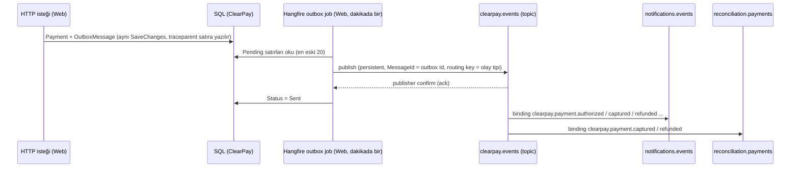

# MESSAGING — RabbitMQ: outbox, retry, dead-letter, idempotent consumer

İlan maddeleri: *"RabbitMQ / mesaj kuyruğu"*, *"mikroservis mimarisi"*. Bu doküman web uygulamasının olayları
RabbitMQ'ya nasıl kaybetmeden bastığını ve iki ayrı servisin (bildirim, mutabakat) bunları nasıl
**en az bir kez (at-least-once)** alıp **tam bir kez etkiyle** işlediğini anlatır.

> **Dürüstlük notu.** Broker gerçek (RabbitMQ 3.13), kod gerçek, testler gerçek broker'a karşı koşuyor.
> Ama yük testi yok, cluster/quorum queue yok, canlı (Azure) ortamda broker yok. E-posta, SMS ve webhook
> gönderimi **sahte**: sadece log satırı + `notif.NotificationLog` tablosuna satır.

## Akış



## Topoloji

| Nesne | Tip | Argümanlar | Ne için |
|-------|-----|-----------|---------|
| `clearpay.events` | topic exchange, durable | — | Tek giriş noktası. Routing key = olay tipi (`clearpay.payment.captured`). |
| `notifications.events` | durable queue | `x-dead-letter-exchange: ""`, `x-dead-letter-routing-key: notifications.events.retry` | Bildirim servisinin iş kuyruğu |
| `notifications.events.retry` | durable queue, **consumer yok** | `x-message-ttl: 5000`, DLX → `notifications.events` | Gecikmeli tekrar: 5 sn bekler, iş kuyruğuna geri döner |
| `notifications.events.dlq` | durable queue | — | Zehirli mesajlar ve denemesi biten mesajlar. İnsan bakar. |
| `reconciliation.payments` (+ `.retry`, `.dlq`) | aynı desen | aynı | Mutabakat servisinin projeksiyon kuyruğu |

Kodu: [`RabbitTopology`](../src/ClearPay.Messaging/RabbitTopology.cs). Her declare idempotent; hem producer hem
consumer açılışta çağırır. Bir kuyruğun argümanını sonradan değiştirmek **yeni kuyruk adı** ister
(RabbitMQ farklı argümanla yeniden declare'i `PRECONDITION_FAILED` ile reddeder).

## Producer: outbox → RabbitMQ

| Karar | Neden |
|-------|-------|
| Olay, iş verisiyle **aynı transaction'da** `OutboxMessage` satırı olur | HTTP bittikten sonra broker'a basmak, timeout/çökme anında olayı kaybettirir. |
| Hangfire job satırı yayınlar, **publisher confirm** bekler (`WaitForConfirmsOrDie`) | Broker "yazdım" demeden satır `Sent` olmaz. |
| `Persistent = true`, kuyruklar durable | Broker restart'ında mesaj kaybolmaz. |
| `MessageId = OutboxMessage.Id` | Aynı satır iki kez gönderilirse (confirm geldi ama `Sent` yazılamadı) consumer aynı id'yi görür ve atlar. |
| Broker kapalıysa satır **Pending kalır**, `Attempts++`, `LastError` dolar; 10 denemeden sonra `Failed` | Eski kod log'a düşüp satırı `Sent` işaretliyordu: olay sessizce kayboluyordu. Şimdi kesinti olayı geciktirir, kaybetmez. |
| `mandatory` kullanılmıyor | Henüz abonesi olmayan olay (ör. `clearpay.topup.completed`) bilinçli olarak düşer; abone olan her servisin kuyruğu durable olduğu için servis kapalıyken bile mesaj bekler. |
| `traceparent` outbox satırında saklanır, header'a yazılır | Yayın, istekten dakikalar sonra başka thread'de olur. Saklanmasa trace HTTP isteğinde kopardı. |

Kodu: [`SqlOutboxProcessor`](../src/ClearPay.Infrastructure/Persistence/SqlOutboxProcessor.cs),
[`RabbitOutboxPublisher`](../src/ClearPay.Infrastructure/Messaging/RabbitOutboxPublisher.cs),
[`RabbitEventPublisher`](../src/ClearPay.Messaging/RabbitEventPublisher.cs). Broker yapılandırılmamışsa
(`ConnectionStrings:RabbitMq` boş: testler, broker'sız laptop demosu) `LoggingOutboxPublisher` kullanılır;
o durumda tüketici de olmadığı için satırı `Sent` işaretlemek bir şey kaybettirmez.

## Consumer: retry, DLQ, idempotency

[`RabbitConsumerService<THandler>`](../src/ClearPay.Messaging/RabbitConsumerService.cs) her mesaj için:

1. `traceparent` header'ından consumer span'ı başlatır (yayın span'ının çocuğu).
2. Yeni DI scope'u açar, handler'ı çağırır (her mesajın kendi `DbContext`'i olur).
3. Sonuç:

| Durum | Ne olur |
|-------|---------|
| Başarılı | `BasicAck` |
| `PoisonMessageException` veya `JsonException` (gövde okunamıyor, zorunlu alan yok, MessageId yok) | Doğrudan `.dlq`'ya kopyala (`x-clearpay-error`, `x-clearpay-attempts` header'ları ile), confirm bekle, orijinali ack'le. Tekrar denemek düzeltmez. |
| Başka hata, deneme < `MaxAttempts` (3) | `BasicNack(requeue: false)` → kuyruk DLX ile `.retry`'a atar → 5 sn TTL → iş kuyruğuna geri döner. Broker her turda `x-death` header'ını günceller. |
| Başka hata, deneme = `MaxAttempts` | `.dlq`'ya kopyala + ack |

Deneme sayısı `x-death` içinde `{queue: Q, reason: rejected}` girdisinin `count` değeridir
([`DeathHeader`](../src/ClearPay.Messaging/DeathHeader.cs)). Uygulama kendi sayaç header'ını tutmaz.

Neden `requeue: true` değil? Anında yeniden kuyruğa koymak, hata düzelmeden aynı mesajı saniyede yüzlerce
kez döndürür (hot loop). TTL'li retry kuyruğu bekleme süresi sağlar. Sabit 5 sn; üstel bekleme
(1 sn / 10 sn / 60 sn) için her kademe ayrı TTL kuyruğu gerekir — bilinçli olarak eklenmedi.

### Idempotency: `ProcessedMessage`

At-least-once teslimat, aynı mesajın iki kez gelebileceği anlamına gelir (outbox yeniden gönderimi, ack'ten
önce çöken consumer). Her serviste:

```text
notif.ProcessedMessage / recon.ProcessedMessage
  Id (PK), MessageId, Consumer, MessageType, ProcessedAt
  UNIQUE INDEX UX_ProcessedMessage_Consumer_MessageId (Consumer, MessageId)
```

[`IdempotentProcessing.RunOnceAsync`](../src/ClearPay.Messaging/ProcessedMessage.cs):

1. Hızlı yol: satır varsa → işlem yok, `false` döner (mesaj yine ack'lenir).
2. Transaction aç → handler kendi satırlarını ekler → `ProcessedMessage` satırı eklenir → **tek `SaveChanges` + commit**.
3. İki kopya aynı anda işlenirse unique index birini düşürür; kaybeden rollback yapar, satırın varlığını görüp
   "zaten işlendi" der.

Veritabanı dışı yan etki (gerçek bir e-posta) transaction'a giremez. Bu yüzden sahte gönderici her çağrıya
`MessageId`'yi **idempotency key** olarak verir; gerçek bir e-posta/SMS/webhook sağlayıcısı bunu
dedup için kullanırdı. Kod yorumunda ve burada bunu açıkça söylüyoruz: yan etki *at-least-once*.

## Olaylar (sözleşme)

Ortak sözleşme projesi: [`src/ClearPay.Contracts`](../src/ClearPay.Contracts) (paket bağımlılığı yok).

| Routing key | Gövde | Producer | Consumer |
|-------------|-------|----------|----------|
| `clearpay.payment.pending_3ds` | `PaymentEventV1` | Web | — (abone yok) |
| `clearpay.payment.authorized` / `failed` / `voided` | `PaymentEventV1` | Web | notifications |
| `clearpay.payment.captured` | `PaymentEventV1` | Web | notifications, reconciliation |
| `clearpay.payment.refunded` | `PaymentEventV1` (`extra.refundId`, `extra.refundAmount`) | Web | notifications, reconciliation |
| `clearpay.payment.refund_failed` | `PaymentEventV1` | Web | notifications |
| `clearpay.reconciliation.mismatch_found` | `ReconciliationMismatchFoundV1` | reconciliation | notifications |
| `clearpay.transfer.completed`, `clearpay.topup.*`, `clearpay.withdraw.*` | anonim JSON (cüzdan) | Web | — (henüz abone yok) |

`PaymentEventV1` ödemenin değişiklik sonrası anlık görüntüsüdür; consumer web uygulamasına geri soru
sormaz. Kart numarası, BIN, son 4 hane yoktur. Yeni anlam = yeni tip adı (`...V2`), mevcut tipi
değiştirmek tüm abonelerin binding'ini kırar.

## Trace: HTTP → outbox → RabbitMQ → consumer

`ClearPayDbContext.SaveChanges` eklenen her `OutboxMessage` satırına o anki `Activity.Id`'yi (W3C
`traceparent`) yazar. Yayıncı bu değeri parent alarak `clearpay.events publish` span'ını açar ve header'a
yazar; consumer `notifications.events process` span'ını onun çocuğu olarak açar. Sonuç: Tempo/Seq'te
tek trace id ile istek, SQL insert, yayın ve tüketim aynı ağaçta. Yardımcı sınıf:
[`MessageTraceContext`](../src/ClearPay.Messaging/MessageTraceContext.cs) (gözlemlenebilirlik ekibinin
sınıfı; servisler Infrastructure'a bağımlı olmasın diye `ClearPay.Messaging`'e taşındı).

## Canlı doğrulama (2026-11-09, `docker-compose.services.yml`)

`docker compose -f docker-compose.services.yml -p clearpay-jobprep up -d --build` ile SQL Server 2022,
RabbitMQ 3.13, web, notifications ve reconciliation container'ları çalıştırıldı;
[`scripts/demo-card-payment.ps1`](../scripts/demo-card-payment.ps1) ile ödemeler yapıldı. Gözlenen:

| Senaryo | Sonuç |
|---------|-------|
| 120.00 TRY ödeme → 3DS → capture → 20.10 kısmi iade | notifications: 3 olay işlendi (authorized, captured, refunded → webhook + finans e-postası). Web isteğinin `TraceId`'si (`827bf2b9…` capture, `861bc56f…` refund) consumer log'unda **aynı** trace id ile göründü. |
| Sipariş no `fail-001` (hata enjeksiyonu açık) | `Attempt 1/3 … retrying in 5s` → `Attempt 2/3` → `moved to notifications.events.dlq after attempt 3`. DLQ mesajında: aynı MessageId, `x-clearpay-error`, `x-clearpay-attempts: 3`, `x-death` (`rejected` ×2, `expired` ×2), `traceparent`. Mutabakat servisi aynı olayı sorunsuz işledi — servisler birbirinin hatasından etkilenmiyor. |
| RabbitMQ durduruldu, 42.00 TRY ödeme yapıldı | Ödeme başarılı (broker ödeme yolunda değil). `/api/health` → `rabbit: down`. 3 outbox satırı `Pending`, `Attempts = 1`, `LastError = BrokerUnavailableException …`. Broker açılınca bir sonraki job turunda üçü de `Sent`, notifications tükettiği log'da görüldü. |
| Sayım | 16 outbox satırı `Sent`, hepsinde `TraceParent` dolu; `notif.NotificationLog` 12 satır, `notif.ProcessedMessage` 10 satır. |

Otomatik testler ([`RabbitIntegrationTests`](../tests/ClearPay.Services.Tests/RabbitIntegrationTests.cs),
`CLEARPAY_TEST_RABBITMQ` ile gerçek broker'a karşı; CI'da RabbitMQ service container):
retry → DLQ (denemeler 1, 2, 3), zehirli mesaj tek denemede DLQ, aynı MessageId iki kez yayınlanınca tek
işlem, consumer span'ının parent'ı publish span'ı.

## Bilinçli olarak yapılmayanlar

- Quorum queue / cluster / mirroring yok: tek node, demo.
- Üstel geri çekilme yok (tek TTL kuyruğu).
- DLQ'dan yeniden gönderme aracı yok: RabbitMQ management UI'dan (`15673`) "Move messages" / shovel ile elle.
- Outbox satırları silinmiyor/arşivlenmiyor.
- Hangfire job'u dakikada bir: olay gecikmesi ≤ 1 dk. Daha düşük gecikme için outbox'ı bir `BackgroundService`
  ile sürekli taramak gerekir.
