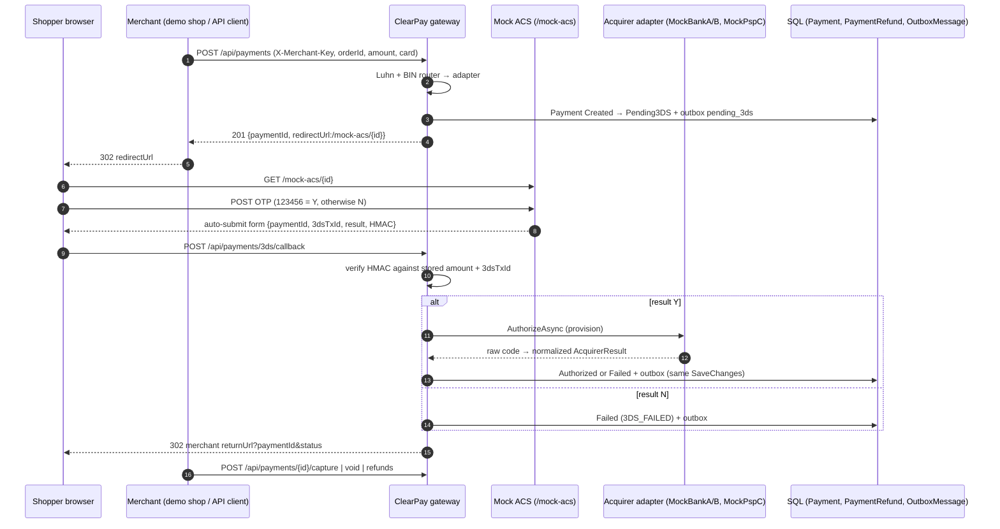
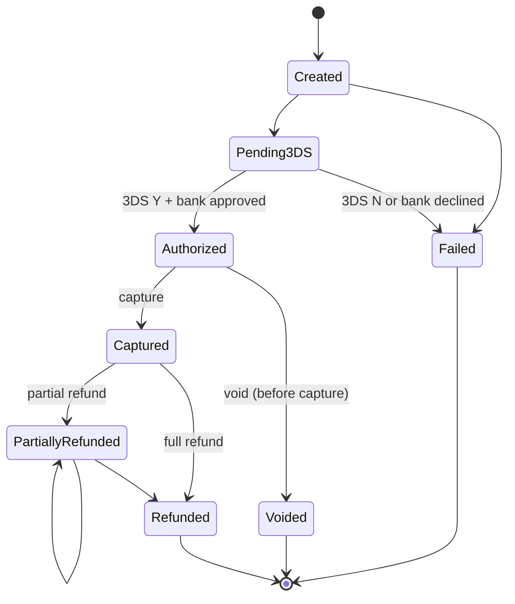

# PAYMENTS — Kartlı ödeme, 3D Secure, iade (MOCK)

> **Dürüst özet:** Bu modül gerçek bir banka veya PSP'ye bağlanmaz. Bankalar (`MockBankA`, `MockBankB`, `MockPspC`),
> 3D Secure ACS sayfası ve SMS kodu **sahtedir** ve aynı ASP.NET Core host'unda çalışır. Gerçek kart numarası
> kullanmayın; PAN saklanmaz ama sistem PCI DSS kapsamı iddia etmez. Amaç: bir ödeme gateway'inin
> **durum makinesi, imzalı callback, idempotency, adaptör normalizasyonu ve eşzamanlı iade korumasını**
> çalışan ve test edilmiş kodla göstermek.

Cüzdan ledger'ından (havale, yükle/çek) ayrı bir bounded context'tir: aynı SQL veritabanı, aynı outbox tablosu,
ama kart ödemesi cüzdan bakiyesine `LedgerEntry` yazmaz (takas/settlement kapsam dışı).

## Akış



## Durum makinesi



Tablonun tek kaynağı `src/ClearPay.Domain/Payments/PaymentStateMachine.cs`. `Payment` üzerindeki her metot
(`StartThreeDs`, `Authorize`, `Fail`, `Capture`, `Void`, `ReserveRefund`, `CompleteRefund`) önce bu tabloya sorar;
izinsiz geçiş `PaymentStateException` olur ve API'de **409** döner.

## Katmanlar (mevcut Onion yapısına uygun)

| Katman | Dosya | Ne yapar |
|--------|-------|----------|
| Domain | `Payments/Payment.cs`, `PaymentRefund.cs`, `PaymentStateMachine.cs` | Durumlar, kuruş kuralı, iade limiti, rezervasyon |
| Application | `Payments/AcquirerContracts.cs` | `IAcquirerAdapter`, normalize `AcquirerResponseCode` |
| Application | `Payments/AcquirerRouter.cs` | BIN önek → adaptör (en uzun önek kazanır) |
| Application | `Payments/ThreeDsSigner.cs` | HMAC-SHA256 imza / sabit-zamanlı doğrulama |
| Application | `Ports/IPaymentGateway.cs` | Use case portu |
| Infrastructure | `Payments/SqlPaymentGateway.cs` | EF yükle/kaydet, adaptör çağrısı, outbox satırı |
| Infrastructure | `Payments/Acquirers/*` | Üç sahte banka/PSP |
| Web | `Controllers/PaymentsController.cs`, `ThreeDsCallbackController.cs` | HTTP eşlemesi |
| Web | `Pages/Payments/MockAcs`, `DemoShop`, `DemoShopResult` | Tıklanabilir demo |

## Adaptörler ve normalizasyon

Üç adaptör aynı arayüzü uygular ama "kendi bankasının dilini" konuşur; gateway hiçbir zaman sağlayıcı adına göre `switch` yazmaz.

| Adaptör | Ham format | Örnek ham yanıt | Normalize |
|---------|-----------|-----------------|-----------|
| `MockBankA` | ISO 8583 tarzı 2 karakter | `00`, `51`, `05`, `14`, `91` | Approved, InsufficientFunds, Declined, InvalidCard, IssuerUnavailable |
| `MockBankB` | SOAP/XML | `<PosResponse><Result>Error</Result><ErrorCode>1051</ErrorCode>…` | 0 / 1051 / 1005 / 1014 / 9999 → aynı enum |
| `MockPspC` | JSON | `{"status":"failed","decline_code":"insufficient_funds"}` | `insufficient_funds`, `generic_decline`, `incorrect_number`, `issuer_not_available` |

Okunamayan yanıt (bozuk XML/JSON, tanınmayan kod) **asla onay sayılmaz** → `Unknown`.

Yönlendirme `appsettings.json` → `Payments:Routing`:

```json
"Routing": { "DefaultProvider": "MockBankA",
             "BinRoutes": { "4": "MockBankA", "5": "MockBankB", "2": "MockBankB", "9792": "MockPspC" } }
```

Router açılışta config'in var olmayan bir adaptörü göstermediğini kontrol eder. Capture/iade/void, ödemeyi
provizyonlayan adaptöre (`Payment.Provider`) geri gider.

### Test kartları ve tetikleyiciler (tüm sahte bankalarda aynı)

| Kart | Yön |
|------|-----|
| `4111111111111111` (Visa) | MockBankA |
| `5555555555554444` (Mastercard) | MockBankB |
| `9792030000000018` (Troy) | MockPspC |
| `4111111111170000` (son 4 = 0000) | InvalidCard |

| Tutarın kuruşu | Sonuç |
|----------------|-------|
| `,51` | InsufficientFunds |
| `,05` | Declined (iadede de: `,05` ile biten iade reddedilir) |
| `,91` | IssuerUnavailable |
| diğer | Approved |

OTP: `123456` doğru; başka her kod veya "İptal" → 3DS `N` → `Failed / 3DS_FAILED`.

## 3D Secure imzası

ACS sonucu tarayıcı üzerinden gelir, yani istemci değiştirebilir. Bu yüzden:

- İmza: `HMAC-SHA256(secret, "{paymentId:N}|{threeDsTransactionId}|{Y|N}|{amount:F2}")`, hex.
- Gateway doğrularken **tutarı ve 3DS işlem id'sini kendi SQL satırından** alır; formdan gelen tutara güvenmez.
- Karşılaştırma `CryptographicOperations.FixedTimeEquals` (zamanlama sızıntısı yok).
- Secret: `Payments:ThreeDs:AcsSecret`. Development'ta açıkça "dev-only" bir değer var; Production'da boş →
  süreç başına rastgele 32 bayt (sahte ACS aynı süreçte olduğu için çalışır, repoda sır yok).
- Geçersiz imza → **400**, ödeme `Pending3DS` kalır, outbox'a bir şey yazılmaz.

## İdempotency

| Nerede | Nasıl |
|--------|-------|
| Ödeme oluşturma | `UX_Payment_MerchantId_MerchantOrderId` unique index. Aynı sipariş no → **409** + mevcut `paymentId`. Yarış durumunda unique ihlali yakalanıp aynı cevap döner. |
| 3DS callback | Ödeme artık `Pending3DS` değilse callback no-op'tur: banka tekrar çağrılmaz, outbox'a ikinci olay yazılmaz, tarayıcı aynı returnUrl'e yönlenir. |
| Eşzamanlı çift callback | İkisi de `Pending3DS` okuduysa, `Version` concurrency token'ı yüzünden ikinci `SaveChanges` `DbUpdateConcurrencyException` alır → `AlreadyProcessed`. |
| Banka tarafı | Adaptöre giden `AcquirerRequest.PaymentId` gerçek bir acquirer'da sipariş/idempotency referansı olurdu. Sahte adaptörler durumsuzdur; çok nadir yarışta mock provizyon iki kez "çağrılabilir" ama SQL'e tek sonuç yazılır. |

## İade, kısmi iade, iptal

- **Void (iptal):** yalnızca `Authorized` → `Voided`. Capture sonrası void **409**; o noktada iade yapılır.
- **Capture:** tam tutar (kısmi capture kapsam dışı).
- **Refund:** `Captured`/`PartiallyRefunded` üzerinde, toplam iade `CapturedAmount`'ı geçemez (**422**).

Eşzamanlılık için iade iki adımdır (*reserve → call → settle*):

1. `ReserveRefund`: `RefundedAmount += amount`, `PaymentRefund{Status=Pending}` eklenir, `SaveChanges`.
   `Payment.Version` bir concurrency token'dır (`UPDATE … WHERE Id=@id AND Version=@old`) ve
   `ClearPayDbContext.SaveChanges` her değişen ödemede onu artırır. Aynı anda iki iade isteği aynı sürümü okuduysa
   yalnızca biri kaydedilir; diğeri **409 ConcurrencyConflict** alır.
2. Banka **ancak rezervasyon commit olduktan sonra** çağrılır. Böylece banka konuşurken gelen ikinci istek
   rezerve edilmiş tutarı görür ve limiti aşamaz (`Reservation_blocks_a_concurrent_over_refund…` testi).
3. Banka onaylarsa `CompleteRefund` (durum `PartiallyRefunded`/`Refunded`), reddederse `ReleaseRefund`
   (rezervasyon geri verilir, durum değişmez, API **402** döner). Bu kayıtta sürüm eskiyse
   (arada başka iade olduysa) satır yeniden okunur ve **aynı banka sonucu** tekrar uygulanır — banka ikinci kez çağrılmaz.

`rowversion` yerine `int Version` seçildi çünkü testler SQLite'ta da aynı davranışı görmeli (SQLite `rowversion` üretmez).
SQL Server'da etkisi aynı: iyimser kilit.

Tutarlar `decimal(18,2)`; `> 0` ve en fazla iki ondalık (kuruş) kuralı Domain'de (`Payment.IsValidMoney`).

## Outbox olayları

Her durum değişikliği ile aynı `SaveChanges` içinde mevcut `OutboxMessage` tablosuna bir satır yazılır
(`CorrelationId = paymentId`, `Status = Pending`). Mevcut Hangfire outbox job'ı bunları yayınlar (Rabbit varsa Rabbit,
yoksa log). Ödeme olaylarını ayrı kuyruğa/consumer'a bağlamak bir sonraki iş.

| Type | Ne zaman |
|------|----------|
| `clearpay.payment.pending_3ds` | Oluşturuldu, 3DS bekliyor |
| `clearpay.payment.authorized` | 3DS Y + banka onayı |
| `clearpay.payment.failed` | 3DS N veya banka reddi (payload `failureCode`, `extra.rawCode`) |
| `clearpay.payment.captured` | Capture |
| `clearpay.payment.voided` | Void |
| `clearpay.payment.refunded` | İade onaylandı (payload `extra.refundId`, `refundAmount`) |
| `clearpay.payment.refund_failed` | İade bankada reddedildi, rezervasyon serbest |

## İzlenebilirlik (tracing)

`IPaymentGateway` ve üç adaptörün her biri gözlemlenebilirlik katmanında decorator ile sarılır
(`TracedCardPayments.cs`); gateway ve adaptör kodu OpenTelemetry bilmez. Bir ödeme şöyle görünür:
`payment card_create` → `payment card_3ds` (child: `acquirer authorize`, Client span) → `payment card_capture`
(child: `acquirer capture`) → `payment card_refund`. Metrik: `clearpay_payments_total{payment_kind="card_3ds", payment_outcome="PaymentFailed"}` gibi.
Sahte imza, eşzamanlılık çakışması ve `IssuerUnavailable` span'i hata olarak işaretler. Span'de PAN, BIN, tutar, OTP ve HMAC yok.
Ayrıntı ve runbook: [`OBSERVABILITY.md`](OBSERVABILITY.md).

## API (üye işyeri)

Kimlik: `X-Merchant-Key` başlığı (`Payments:Merchants`). Development: `demo-shop` / `dev-demo-shop-key`.
Production config'inde işyeri yok → API **401**.

| Metot | Yol | Cevap |
|-------|-----|-------|
| POST | `/api/payments` | 201 `{paymentId, status, provider, redirectUrl}` · 400 · 409 (aynı sipariş) |
| GET | `/api/payments/{id}` | 200 `PaymentView` · 404 (başka işyeri dahil) |
| POST | `/api/payments/{id}/capture` | 200 · 409 (yanlış durum) |
| POST | `/api/payments/{id}/void` | 200 · 409 |
| POST | `/api/payments/{id}/refunds` `{amount, reason}` | 201 · 422 (limit) · 409 · 402 (banka reddi) |
| POST | `/api/payments/3ds/callback` (form) | 302 → returnUrl · 400 (imza) · 404 |

```bash
curl -s -X POST http://localhost:5153/api/payments \
  -H "X-Merchant-Key: dev-demo-shop-key" -H "Content-Type: application/json" \
  -d '{"merchantOrderId":"ORD-1","amount":250.40,"currency":"TRY","cardNumber":"4111111111111111","returnUrl":"/demo-magaza/sonuc"}'
# tarayıcıda redirectUrl'i aç → OTP 123456 → demo sonuç sayfası
curl -s -X POST http://localhost:5153/api/payments/{id}/capture -H "X-Merchant-Key: dev-demo-shop-key"
curl -s -X POST http://localhost:5153/api/payments/{id}/refunds -H "X-Merchant-Key: dev-demo-shop-key" \
  -H "Content-Type: application/json" -d '{"amount":100.20}'
```

Tarayıcıdan: [`/demo-magaza`](http://localhost:5153/demo-magaza) → test kartı seç → OTP → sonuç sayfasında Capture / Void / İade.

## Testler

| Dosya | Kapsam |
|-------|--------|
| `PaymentDomainTests` | Geçiş tablosu, kuruş kuralı, void/iade sırası, kısmi iade limiti, rezervasyon/serbest bırakma |
| `AcquirerAdapterTests` | Üç ham format → aynı normalize kod, router en uzun önek, hatalı config, HMAC kurcalama |
| `PaymentGatewayTests` | SQLite üzerinde gerçek EF: mutlu yol + outbox sırası, OTP hatası, banka retleri, sahte imza, çift ve paralel callback, void kuralları, başka işyeri, reddedilen iade, eşzamanlı iade yarışları, eski kopya ile kayıt |
| `CardPaymentTracingTests` | Decorator kayıtları, uçtan uca span ağacı (create → 3ds → acquirer authorize → capture), sahte imza = hata span'i, yanlış OTP = `PaymentFailed`, metrik etiketleri, span'de kart verisi yok |
| `ThreeDsFlowTests` | HTTP uçtan uca: API anahtarı, ACS sayfası + antiforgery, imzalı form, 302, çift callback, kurcalanmış imza 400, capture/void/iade kodları, demo mağaza |

`dotnet test ClearPay.slnx`. Migration (`AddCardPayments`) ayrıca geçici bir SQL Server 2022 container'ında
`dotnet ef database update` ile uygulanıp aynı akış `curl` ile SQL Server üzerinde denendi.

## Bilinen sınırlar

- Banka, PSP, ACS, SMS: hepsi sahte ve aynı süreçte. Gerçek EMV 3DS mesajları (AReq/ARes/CReq/CRes) yok; akış onların sadeleştirilmiş hâli.
- PAN API'de bir kez alınır (BIN + son 4 için), saklanmaz; yine de PCI kapsamı iddia edilmez.
- Üye işyerine bildirim: tarayıcı redirect'i + outbox olayı. Sunucudan sunucuya webhook yok.
- Kısmi capture, taksit, çoklu para birimi kuru, chargeback, settlement/mutabakat dosyası yok (mutabakat ayrı iş).
- İade isteğinde ayrı bir `Idempotency-Key` yok; aynı iadeyi iki kez göndermek iki iade dener (limit yine korunur).
