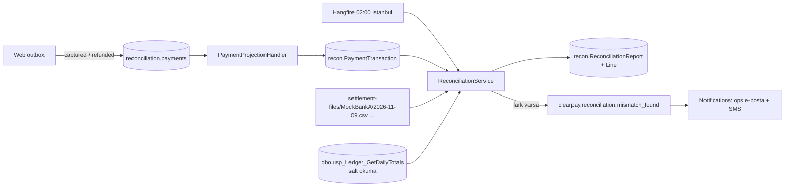

# RECONCILIATION — gece mutabakatı (gün sonu settlement)

İlan maddesi: *"mutabakat / gün sonu işlemleri"*, *"Hangfire / zamanlanmış görevler"*. Her gece 02:00'de
(Europe/Istanbul) bir önceki günün kart işlemleri, her banka/PSP'nin gün sonu dosyasıyla eşleştirilir.

> **Dürüstlük notu.** Bankalar sahte. Web uygulamasındaki mock banka adaptörleri durumsuzdur (cevabı tutarın
> kuruşuna göre verir, kayıt tutmaz), yani dışa aktarılacak gerçek bir "banka tarafı" yok. Bu yüzden settlement
> CSV'sini bir **mock üretici** oluşturur: ClearPay'in o gün o sağlayıcıda gördüğü paradan başlar ve aşağıdaki
> sabit, belgelenmiş anormallikleri uygular. Eşleştirme, raporlama, olay yayını ve zamanlama gerçek koddur;
> "banka" sahtedir.

## Bileşenler

| Parça | Dosya | Görev |
|-------|-------|-------|
| Projeksiyon consumer | [`PaymentProjectionHandler`](../src/ClearPay.Reconciliation/PaymentProjectionHandler.cs) | `clearpay.payment.captured` → `SALE`, `clearpay.payment.refunded` → `REFUND` satırı (`recon.PaymentTransaction`). İdempotent. |
| Settlement dosyası | [`Settlement.cs`](../src/ClearPay.Reconciliation/Settlement.cs) | `{SettlementDirectory}/{sağlayıcı}/{yyyy-MM-dd}.csv` okur; yoksa mock banka üretir ("üret/al"). |
| Eşleştirici | [`ReconciliationMatcher`](../src/ClearPay.Reconciliation/ReconciliationMatcher.cs) | Saf fonksiyon, I/O yok. Anahtar = (sağlayıcı, kayıt tipi, referans). |
| Ledger kontrolü | [`SqlLedgerDailyTotals`](../src/ClearPay.Reconciliation/LedgerDailyTotals.cs) | T-SQL ekibinin `dbo.usp_Ledger_GetDailyTotals` SP'sini çağırır. |
| Servis | [`ReconciliationService`](../src/ClearPay.Reconciliation/ReconciliationService.cs) | Rapor + satırlar tek `SaveChanges`, fark varsa olay yayını. |
| Job | [`NightlyReconciliationJob`](../src/ClearPay.Reconciliation/NightlyReconciliationJob.cs) | Hangfire recurring `reconciliation-nightly`, Cron `0 2 * * *`, TimeZone `Europe/Istanbul`. |
| Host | [`ReconciliationProgram`](../src/ClearPay.Reconciliation/ReconciliationProgram.cs) | Hangfire server + dashboard `/hangfire`, API. |



## Neden "bizim taraf" bir projeksiyon?

Mutabakat servisi web uygulamasının `dbo.Payment` tablosunu **okumaz**. Captured/refunded olaylarından kendi
tablosunu doldurur. Böylece:

- web şeması değişince mutabakat kırılmaz (sözleşme = `PaymentEventV1`);
- servis kendi veritabanına taşınabilir (compose'ta zaten ayrı veritabanı: `ClearPayReconciliation`).

Bedeli: projeksiyon olaylardan ≤ 1 dk geride kalabilir (outbox job dakikada bir). 02:00'de bir önceki günü
mutabık ettiğimiz için bu sorun değil. Gün sınırı Istanbul takvim günüdür (`BusinessDay`); 23:30 Istanbul
(20:30 UTC) bir capture o günün dosyasındadır. Satıra `BusinessDate` (date) kolonu yazılır, job tarih
aralığı değil eşitlik sorgular.

## Sonuç sınıfları

| Durum | Anlamı | Mock'ta nasıl oluşur |
|-------|--------|----------------------|
| `Matched` | Aynı anahtar, aynı tutar ve para birimi | Varsayılan |
| `AmountMismatch` | Anahtar iki tarafta da var, tutar farklı | SALE kuruşu **.37** → banka 1.00 fazla yazar |
| `OnlyInClearPay` | Biz capture ettik, banka dosyasında yok | SALE kuruşu **.73** → bankada yok |
| `OnlyAtBank` | Bankada var, bizde kaydı yok | SALE kuruşu **.66** → banka ek bir `BANK-…` satırı gönderir |
| `LedgerImbalance` | Cüzdan ledger'ında bir tür için +/- çiftleri sıfıra kapanmıyor | `usp_Ledger_GetDailyTotals` `Net ≠ 0` döndürürse |

Bu kuruş değerleri ödeme modülünün banka senaryolarıyla çakışmaz (.05 / .51 / .91 red için kullanılıyor).
Elle konmuş bir dosya (üretici işareti `source=clearpay-mock-generator` olmayan) olduğu gibi okunur — bir
"gerçek" banka dosyasını denemek için klasöre bırakmak yeterli. Bozuk satır `FormatException` (satır
numarasıyla) fırlatır ve **rapor yazılmaz**: yarım okunmuş dosya "temiz gün" gibi görünmemeli. Hangfire job'u
3 kez dener, sonra dashboard'da Failed görünür.

CSV biçimi (üç mock banka için tek biçim; gerçek bankaların her biri farklıdır — sabit genişlik, ISO 20022 camt.053 …):

```text
# provider=MockPspC;date=2026-11-09;source=clearpay-mock-generator
record_type,reference,amount,currency
SALE,3c21a716-3983-4b4b-ac91-09d4155f28cf,10.66,TRY
SALE,BANK-3C21A716,10.66,TRY
```

## T-SQL ekibinin SP'si: tek bağlantı noktası

`dbo.usp_Ledger_GetDailyTotals @DayStart, @DayEnd` cüzdan ledger'ında gün içindeki her tür için kayıt sayısı,
alacak, borç ve net döndürür; tek index range seek ([`SQL-PERF.md`](SQL-PERF.md): 10,783 → 13 logical read).
Her cüzdan hareketi +/- çift olduğu için Net ≠ 0 yarım yazılmış bir çift demektir. Mutabakat servisi bu
SP'yi `ConnectionStrings:LedgerReadOnly` ile çağırır — web veritabanına tek dokunuşu budur, ve tablo değil
**tek bir SP'ye EXECUTE**'dur. Üretimde bu bağlantı yalnızca o yetkiye sahip bir login olmalı (compose
demosunda `sa` + `ApplicationIntent=ReadOnly`). Bağlantı boşsa rapor `LedgerCheck = Skipped` der; SP hata
verirse `Failed` der ve kart mutabakatı yine kaydedilir.

## Olay ve mini outbox

Rapor satırı aynı zamanda servisin outbox'ıdır: `MismatchEventPublishedAt` null ve farkı olan her rapor
için `clearpay.reconciliation.mismatch_found` yayınlanır (`MessageId = ReportId`), confirm gelince tarih
yazılır. Broker kapalıysa bir sonraki çalıştırma gönderir; aynı rapor iki kez gönderilse bile notifications
servisinin `ProcessedMessage` tablosu ikinciyi atar.

## API (iç ağ için; kimlik doğrulama yok)

| Uç | Ne yapar |
|----|----------|
| `POST /api/reconciliation/runs?date=yyyy-MM-dd` | O gün için hemen çalıştır, raporu satırlarıyla döndür. `date` yoksa dün (Istanbul). |
| `GET /api/reconciliation/reports` | Son 20 rapor özeti |
| `GET /api/reconciliation/reports/{id}` | Rapor + satırlar |
| `GET /api/reconciliation/settlement-files/{sağlayıcı}/{tarih}` | Job'un okuduğu CSV |
| `GET /hangfire` | Hangfire dashboard: recurring job, "Trigger now", geçmiş, hatalar |
| `GET /api/health` | `rabbit: up/down/off` |

Dashboard varsayılan olarak yalnızca yerel isteklere açıktır (Hangfire `LocalRequestsOnlyAuthorizationFilter`).
Compose demosu `Reconciliation:DashboardOpenToAll=true` ile açar — yalnızca yerel demo için.

## Canlı doğrulama (2026-11-09)

Compose yığını üzerinde 10.37 (MockBankA), 10.73 (MockBankB), 10.66 (MockPspC) TRY ödemeleri capture
edildi, sonra `POST /api/reconciliation/runs?date=2026-11-09`:

```text
matched 4, onlyAtBank 1, onlyInClearPay 1, amountMismatch 1, ledgerImbalance 0, ledgerCheck Balanced
bankNetTotal 207.59, clearPayNetTotal 206.66, mismatchEventPublishedAt 12:34:02Z
MockBankA SALE   4a2bc327-…  AmountMismatch  bank=11.37 ours=10.37
MockBankA SALE   5c37ea66-…  Matched         bank=120   ours=120
MockBankA REFUND 8bfaac00-…  Matched         bank=20.1  ours=20.1
MockBankA SALE   b32d0b74-…  Matched         bank=75    ours=75
MockBankB SALE   de0744be-…  OnlyInClearPay  bank=—     ours=10.73
MockPspC  SALE   bank-3c21a716 OnlyAtBank    bank=10.66 ours=—
MockPspC  SALE   3c21a716-…  Matched         bank=10.66 ours=10.66
```

Aynı saniyede notifications servisi `FAKE Email to ops@clearpay.local: Reconciliation 2026-11-09: 1 only at
bank, 1 only in ClearPay, 1 amount differences, 0 ledger imbalances` ve on-call SMS satırlarını yazdı.
Hangfire dashboard `reconciliation-nightly` işini `0 2 * * *` / `Europe/Istanbul` ile listeledi.

Birim testleri ([`ReconciliationTests`](../tests/ClearPay.Services.Tests/ReconciliationTests.cs)): dört sonuç
sınıfı, Istanbul gün sınırı, CSV hataları satır numarasıyla, elle bırakılan dosyanın üreticiyi ezmesi, broker
kapalıyken olayın bir sonraki çalıştırmada gitmesi, bozuk dosyada rapor yazılmaması.

## Kapsam dışı

- Gerçek SFTP / banka entegrasyonu, komisyon (MDR) ve net settlement hesabı, valör tarihi.
- Farkların çözüm akışı (ops ekranı, "çözüldü" işareti).
- Aynı gün için ikinci çalıştırma yeni rapor üretir; eski rapor geçmiş olarak kalır (üzerine yazılmaz).
